# Plano de Execução: Catálogo e navegação por categorias

**PRD de referência:** `docs/prds/PRD-001-catalogo-e-categorias.md`
**SPEC-UI de referência:** `docs/prototype/SPEC-UI-001-catalogo-e-categorias.md` (protótipo em `docs/prototype/prototipo-001/`)
**Arquitetura de referência:** `docs/architecture/proposta-arquitetural.md` (v0.5)
**Cliente/Produto:** Flora Bambini (e-commerce local)
**Stack:** ASP.NET Core MVC (.NET 10), Razor, EF Core 10 Code First, SQL Server (Azure SQL em produção), Azure Blob Storage, xUnit
**Autor:** Michel Banagouro
**Data:** 2026-10-11
**Status:** Em execução

Os caminhos de arquivo das tarefas são relativos a `src/FloraBambini.Web/`, salvo quando começam por `tests/` ou `docs/`.

---

## 1. Resumo executivo

O repositório ainda não tem código: este plano cria a aplicação e entrega o catálogo inteiro do PRD-001. A quebra vai de dentro para fora. Primeiro a fundação (projeto, banco, entidades, autorização do painel), depois as regras de categorias, marcas e produtos como serviços testáveis sem tela, depois a vitrine e por fim o painel, que é onde está a maior parte das telas. Cada tela é construída sobre regra já testada, e os componentes compartilhados da SPEC-UI viram tarefa própria antes das telas que os usam. São 49 tarefas em 6 fases.

## 2. Estratégia de entrega

**Modelo de entrega:** incremental por fase, em ambiente local. **Este plano não publica em produção.** O painel exige o perfil `Admin` e o login da administradora pertence ao PRD de autenticação, que foi adiado; até ele existir, o painel só é acessível em desenvolvimento (ver premissas). A ordem das fases 4 e 5 pode ser invertida sem prejuízo: as duas dependem só das fases 1 a 3.

**Critério geral de "pronto":** os 47 cenários do PRD-001 verificados (por teste automatizado, ou por inspeção contra o protótipo onde o plano indica), todas as telas UI-01 a UI-10 com os estados da SPEC-UI, suíte de testes verde e review aprovado de cada tarefa.

## 3. Premissas e decisões

> ⚠️ **Premissa:** estrutura de um projeto web e um de testes (`src/FloraBambini.Web`, `tests/FloraBambini.Tests`), com pasta por módulo de negócio contendo domínio, dados, serviços, controllers e views (ADR-001). O plano adota `Catalogo/{Dominio,Dados,Servicos,Loja,Admin}` e `Compartilhado/`. Se você preferir outra organização, ela muda os caminhos de todas as tarefas; por isso a T-01 tem ponto de validação.

> ⚠️ **Premissa:** código de domínio em português (`Categoria`, `Produto`, `ServicoDeCategorias`), acompanhando o vocabulário do PRD.

> ⚠️ **Premissa:** testes com xUnit. Regras puras em teste de unidade; unicidade, concorrência e consultas em teste de integração contra **SQL Server LocalDB**; rotas e telas renderizadas no servidor com `WebApplicationFactory`. Não há padrão de testes declarado na arquitetura, e LocalDB foi escolhido porque o desenvolvimento é em Windows e as regras dependem de comportamento real do SQL Server (`rowversion`, índice único).

> ⚠️ **Premissa:** comportamento que só existe em JavaScript (rolagem automática, ampliação de imagem, diálogos, sugestão de endereço, editor de descrição) não tem teste automatizado. É verificado por inspeção contra o protótipo, nos pontos de validação humana. Não entra ferramenta de teste de navegador neste plano.

> ⚠️ **Premissa:** enquanto o PRD de autenticação não existir, o acesso ao painel em desenvolvimento usa um esquema de autenticação **registrado somente no ambiente `Development`**, que autentica como `Admin`. A política da área já exige o perfil real (RN-35), e nenhum outro ambiente registra esse esquema. Consequência: sem o PRD de autenticação, o painel não tem como ser usado em produção.

> ⚠️ **Premissa:** em desenvolvimento, as imagens vão para o emulador **Azurite**; em teste automatizado, para uma implementação em memória da mesma abstração. Provisionamento do Azure e pipeline de publicação (proposta, §11, passos 3 e 4) ficam fora deste plano.

> ⚠️ **Premissa:** bibliotecas escolhidas por serem o caminho mais trilhado para cada necessidade: **SixLabors.ImageSharp** para redimensionar e cortar imagens, **HtmlSanitizer** (Ganss.Xss) para sanear a descrição e **Quill** como editor, restrito aos formatos da RN-20. O ImageSharp tem licença dividida, gratuita para projeto de código aberto e para empresa pequena; confirme que serve antes da T-21.

> ⚠️ **Premissa:** a faixa de avisos da vitrine (mantida por decisão sua na SPEC-UI) lê os textos da configuração e não aparece quando a lista está vazia. Os textos do design não entram no código, porque não correspondem a regra nenhuma da loja.

> ⚠️ **Premissa:** a ordenação e a divisão em lotes da listagem são feitas em memória sobre os produtos ativos da subárvore. O catálogo tem menos de 100 produtos (§2.4), e a ordenação "Mais vendidos" depende de um dado que virá de outro módulo.

Decisões técnicas já tomadas:

- **Decisão:** monolito MVC com Razor no servidor, loja na raiz e painel em `Area` — *referência: ADR-001*
- **Decisão:** EF Core Code First sem repositório genérico; imagens em Blob Storage com URL pública — *referência: ADR-002*
- **Decisão:** perfil `Admin` exigido por política aplicada à área inteira — *referência: ADR-004*
- **Decisão:** controle de concorrência otimista no produto, porque o estoque também será alterado por pedidos — *referência: ADR-007*
- **Decisão:** categoria auto-relacionada, árvore lida em memória com cache no processo, marca como entidade própria — *referência: ADR-010*
- **Decisão (SPEC-UI, seção 8):** galeria só aceita envio depois do primeiro salvamento; posição entre irmãs por setas; abas e filtro por nome na listagem de produtos do painel; imagens 1:1; "Início" no breadcrumb.

## 4. Mapa de dependências

```mermaid
graph TD
    subgraph F1[Fase 1 — Fundação]
        T01[T-01 Projeto] --> T02[T-02 Banco e testes]
        T02 --> T03[T-03 Categoria e Marca]
        T03 --> T04[T-04 Produto e Imagem]
        T01 --> T05[T-05 Slug]
        T01 --> T06[T-06 Autorização]
    end
    subgraph F2[Fase 2 — Categorias e marcas]
        T03 --> T07[T-07 Árvore em memória]
        T05 --> T08[T-08 Criar e editar]
        T07 --> T08
        T08 --> T09[T-09 Profundidade e ciclo]
        T08 --> T10[T-10 Redirecionamentos]
        T09 --> T11[T-11 Impacto]
        T10 --> T11
        T08 --> T12[T-12 Excluir e reordenar]
        T04 --> T12
        T07 --> T13[T-13 Contagem]
        T04 --> T13
        T04 --> T14[T-14 Marcas]
    end
    subgraph F3[Fase 3 — Produtos]
        T04 --> T15[T-15 Criar e editar]
        T05 --> T15
        T15 --> T16[T-16 Preço e estoque]
        T15 --> T17[T-17 Concorrência]
        T15 --> T18[T-18 Sanitização]
        T15 --> T19[T-19 Redirec. de produto]
        T10 --> T19
        T02 --> T20[T-20 Armazenamento]
        T20 --> T21[T-21 Versões de imagem]
        T21 --> T22[T-22 Galeria]
        T15 --> T22
        T22 --> T23[T-23 Ativar e inativar]
        T13 --> T23
    end
    subgraph F4[Fase 4 — Vitrine]
        T01 --> T24[T-24 Layout e 404]
        T24 --> T25[T-25 Menu]
        T13 --> T25
        T24 --> T26[T-26 Rota de categoria]
        T10 --> T26
        T16 --> T27[T-27 Consulta]
        T07 --> T27
        T27 --> T28[T-28 Marca e lotes]
        T24 --> T29[T-29 Card, preço, breadcrumb]
        T16 --> T29
        T26 --> T30[T-30 Listagem]
        T28 --> T30
        T29 --> T30
        T30 --> T31[T-31 Rolagem]
        T29 --> T32[T-32 Página de produto]
        T23 --> T32
        T19 --> T32
        T18 --> T32
        T32 --> T33[T-33 Galeria da loja]
    end
    subgraph F5[Fase 5 — Painel]
        T06 --> T34[T-34 Layout do painel]
        T34 --> T35[T-35 Componentes]
        T35 --> T36[T-36 Seletor e endereço]
        T35 --> T37[T-37 Árvore]
        T12 --> T37
        T13 --> T37
        T36 --> T38[T-38 Form. categoria]
        T09 --> T38
        T38 --> T39[T-39 Aviso de impacto]
        T11 --> T39
        T35 --> T40[T-40 Marcas]
        T14 --> T40
        T35 --> T41[T-41 Lista de produtos]
        T16 --> T41
        T41 --> T42[T-42 Ativar na lista]
        T23 --> T42
        T36 --> T43[T-43 Form. produto]
        T16 --> T43
        T19 --> T43
        T43 --> T44[T-44 Editor]
        T18 --> T44
        T43 --> T45[T-45 Conflito]
        T17 --> T45
        T43 --> T46[T-46 Envio de imagens]
        T22 --> T46
        T46 --> T47[T-47 Ordem e remoção]
        T43 --> T48[T-48 Situação]
        T23 --> T48
    end
    T25 --> T49[T-49 Invalidação ponta a ponta]
    T39 --> T49
    T48 --> T49
    T37 --> T49
```

## 5. Fases

### Fase 1 — Fundação

**Objetivo da fase:** ter a aplicação de pé, com banco, entidades do catálogo, utilitário de endereço e o painel fechado para quem não é `Admin`.

**Critério de conclusão da fase:** a aplicação sobe, as migrations criam o banco do zero, a suíte roda e qualquer rota de `/admin` recusa quem não tem o perfil.

---

#### T-01 — Criar a solução, os projetos e a convenção de módulos

- **Status:** Concluído
- **Complexidade:** Média
- **Depende de:** nenhuma
- **Implementa:** —
- **Valida:** —
- **Decisões base:** ADR-001
- **Camadas/arquivos afetados:**
  - `FloraBambini.sln` *(novo, na raiz do repositório)*
  - `Program.cs`, `FloraBambini.Web.csproj`, `appsettings.json`, `appsettings.Development.json` *(novos)*
  - `Compartilhado/Mvc/LocalizadorDeViewsPorModulo.cs` *(novo)*
  - `tests/FloraBambini.Tests/FloraBambini.Tests.csproj`, `tests/FloraBambini.Tests/Infra/AplicacaoDeTeste.cs` *(novos)*

**Descrição:**
Criar o projeto MVC em .NET 10 e o projeto de testes xUnit. Configurar o MVC para achar views dentro da pasta do módulo (`Catalogo/Loja/Views`, `Catalogo/Admin/Views`) e a rota da área `Admin` sob `/admin`. Deixar uma classe base de teste com `WebApplicationFactory` para as próximas tarefas.

**Critério de aceite (testável):**
- [x] `dotnet build` e `dotnet test` passam na raiz do repositório
- [x] Um controller de exemplo dentro de uma pasta de módulo tem a view encontrada, na raiz e na área `Admin`
- [x] Segredos e connection strings ficam fora do repositório (user secrets em desenvolvimento)

**Testes a escrever:**
- *Integration:* `Aplicacao_sobe_e_responde`, `View_de_modulo_e_localizada_na_raiz_e_na_area_Admin`

**Riscos / pontos de atenção:**
- A organização de pastas é premissa (seção 3). **Ponto de validação humana** ao fim desta tarefa.
- O controller de exemplo é removido quando a primeira tela real entrar (T-24).

---

#### T-02 — Configurar o EF Core, o contexto e a base de testes com banco

- **Status:** Concluído
- **Complexidade:** Média
- **Depende de:** T-01
- **Implementa:** —
- **Valida:** —
- **Decisões base:** ADR-002
- **Camadas/arquivos afetados:**
  - `Dados/LojaDbContext.cs` *(novo)*
  - `Program.cs` *(editado)*
  - `tests/FloraBambini.Tests/Infra/BancoDeTeste.cs` *(novo)*

**Descrição:**
Registrar o `LojaDbContext` com SQL Server, sem repositório genérico por cima. Criar o suporte de teste que gera um banco LocalDB limpo por classe de teste, aplica as migrations e o descarta ao final.

**Critério de aceite (testável):**
- [x] A aplicação abre conexão com o banco configurado em desenvolvimento
- [x] Um teste de integração cria o banco pelas migrations, grava e lê, e o banco some ao fim da execução

**Testes a escrever:**
- *Integration:* `Banco_de_teste_e_criado_pelas_migrations_e_descartado`

**Riscos / pontos de atenção:**
- Testes de integração em paralelo precisam de bancos com nomes distintos.

---

#### T-03 — Criar as entidades Categoria e Marca com o mapeamento

- **Status:** Concluído
- **Complexidade:** Baixa
- **Depende de:** T-02
- **Implementa:** —
- **Valida:** —
- **Decisões base:** ADR-010, ADR-002
- **Camadas/arquivos afetados:**
  - `Catalogo/Dominio/Categoria.cs`, `Catalogo/Dominio/Marca.cs` *(novos)*
  - `Catalogo/Dados/CategoriaConfiguration.cs`, `Catalogo/Dados/MarcaConfiguration.cs` *(novos)*
  - `Dados/Migrations/*_CategoriasEMarcas.cs` *(novo)*

**Descrição:**
`Categoria` com nome, slug, categoria pai opcional e posição; `Marca` com nome. Índice único em (pai, slug), que no SQL Server também impede duas raízes com o mesmo slug, e índice único no nome da marca com comparação sem distinção de maiúsculas. Só estrutura; as regras entram na Fase 2.

**Critério de aceite (testável):**
- [x] A migration cria as duas tabelas e os dois índices únicos
- [x] O banco recusa duas categorias com o mesmo slug sob o mesmo pai, inclusive entre raízes, e aceita o mesmo slug sob pais diferentes

**Testes a escrever:**
- *Integration:* `Indice_recusa_slug_repetido_entre_irmas_e_entre_raizes`, `Indice_aceita_mesmo_slug_sob_pais_diferentes`

**Riscos / pontos de atenção:**
- **Ponto de validação humana:** revisar o SQL da migration antes de seguir.
- A exclusão de categoria com filhas precisa ser restrita no banco, nunca em cascata.

---

#### T-04 — Criar as entidades Produto e ImagemProduto com o mapeamento

- **Status:** Pendente
- **Complexidade:** Baixa
- **Depende de:** T-03
- **Implementa:** —
- **Valida:** —
- **Decisões base:** ADR-002, ADR-007
- **Camadas/arquivos afetados:**
  - `Catalogo/Dominio/Produto.cs`, `Catalogo/Dominio/ImagemProduto.cs` *(novos)*
  - `Catalogo/Dados/ProdutoConfiguration.cs`, `Catalogo/Dados/ImagemProdutoConfiguration.cs` *(novos)*
  - `Dados/Migrations/*_Produtos.cs` *(novo)*
  - `Dados/LojaDbContext.cs` *(editado: `DbSet` de `Produto` e `ImagemProduto`)*
  - `tests/FloraBambini.Tests/Catalogo/IndicesERestricoesDeProdutoTests.cs` *(novo)*

**Descrição:**
`Produto` com nome, slug, categoria, marca, preço, preço promocional opcional, estoque, descrição, situação (ativo ou inativo), data de cadastro e coluna de versão de linha. `ImagemProduto` com produto, posição e a chave das versões no armazenamento. Preço em `decimal(10,2)`; slug com índice único global; categoria e marca com exclusão restrita.

**Critério de aceite (testável):**
- [ ] A migration cria as tabelas, o índice único de slug e as chaves estrangeiras restritas
- [ ] O banco recusa excluir categoria ou marca referenciada por produto

**Testes a escrever:**
- *Integration:* `Banco_recusa_excluir_categoria_ou_marca_com_produto`, `Indice_recusa_slug_de_produto_repetido`

**Riscos / pontos de atenção:**
- **Ponto de validação humana:** revisar o SQL da migration.
- Dinheiro nunca passa por ponto flutuante (ADR-003): `decimal` de ponta a ponta.

---

#### T-05 — Implementar o gerador de slug e a lista de endereços reservados

- **Status:** Pendente
- **Complexidade:** Baixa
- **Depende de:** T-01
- **Implementa:** RN-03, RN-04
- **Valida:** —
- **Decisões base:** ADR-010
- **Camadas/arquivos afetados:**
  - `Catalogo/Dominio/Slug.cs` *(novo)*
  - `Catalogo/Servicos/EnderecosReservados.cs` *(novo)*
  - `tests/FloraBambini.Tests/Catalogo/SlugTests.cs`, `tests/FloraBambini.Tests/Catalogo/EnderecosReservadosTests.cs` *(novos)*

**Descrição:**
Função pura que transforma um nome em slug (minúsculas, sem acentos, espaços e pontuação viram hífen, sem hífen repetido nem nas pontas) e que valida um slug digitado. `EnderecosReservados` responde se um slug de raiz colide com uma rota da aplicação; a lista é derivada das rotas registradas, com os segmentos fixos do PRD como piso (`produto`, `admin`, `carrinho`, `checkout`, `conta`).

**Critério de aceite (testável):**
- [ ] "Shampoo de Camomila" vira `shampoo-de-camomila`; "Acessórios" vira `acessorios`
- [ ] Slug com caractere inválido é recusado na validação
- [ ] `produto` e `admin` são reservados; `flora` não é

**Testes a escrever:**
- *Unit:* `Slug_e_gerado_sem_acentos_e_com_hifens`, `Slug_invalido_e_recusado`, `CA_04_Slug_de_rota_existente_e_reservado`

**Riscos / pontos de atenção:**
- Rota nova criada por outro PRD precisa entrar na lista sozinha; por isso ela vem das rotas, não só de uma constante.

---

#### T-06 — Fechar a área do painel para o perfil Admin

- **Status:** Pendente
- **Complexidade:** Média
- **Depende de:** T-01
- **Implementa:** RN-35
- **Valida:** CA-43
- **Decisões base:** ADR-001, ADR-004
- **Camadas/arquivos afetados:**
  - `Compartilhado/Acesso/PoliticaDoPainel.cs` *(novo)*
  - `Compartilhado/Acesso/AutenticacaoDeDesenvolvimento.cs` *(novo)*
  - `Program.cs` *(editado)*
  - `tests/FloraBambini.Tests/Infra/AutenticacaoDeTeste.cs` *(novo)*
  - `tests/FloraBambini.Tests/Compartilhado/Acesso/PoliticaDoPainelTests.cs` *(novo)*

**Descrição:**
Aplicar uma política que exige o perfil `Admin` a todos os controllers da área, por convenção, sem depender de atributo em cada controller. Registrar, só no ambiente `Development`, um esquema que autentica como `Admin`. Nos testes, um esquema próprio permite simular visitante anônimo, perfil `Cliente` e perfil `Admin`.

**Critério de aceite (testável):**
- [ ] Visitante anônimo e usuário com perfil `Cliente` têm o acesso negado em leitura e em envio de dados, e nada é alterado (CA-43)
- [ ] Um controller novo na área fica protegido sem nenhuma anotação
- [ ] Fora de `Development`, o esquema de desenvolvimento não está registrado

**Testes a escrever:**
- *Integration:* `CA_43_Anonimo_nao_acessa_o_painel`, `CA_43_Perfil_Cliente_nao_acessa_o_painel`, `Controller_novo_da_area_nasce_protegido`, `Esquema_de_desenvolvimento_nao_existe_em_Production`

**Riscos / pontos de atenção:**
- **Ponto de validação humana:** é a tarefa que mais pode abrir o painel por engano. Revisar antes de seguir.
- A vitrine continua pública: a política vale só para a área.

---

### Fase 2 — Categorias e marcas

**Objetivo da fase:** todas as regras de categoria e de marca funcionando como serviços, sem tela.

**Critério de conclusão da fase:** RN-01 a RN-13 cobertas por teste, e os cenários CA-01 a CA-15, CA-17 e CA-18 verdes no nível de serviço.

---

#### T-07 — Carregar a árvore de categorias em memória, com invalidação

- **Status:** Pendente
- **Complexidade:** Média
- **Depende de:** T-03
- **Implementa:** RN-11
- **Valida:** —
- **Decisões base:** ADR-010
- **Camadas/arquivos afetados:**
  - `Catalogo/Servicos/ArvoreDeCategorias.cs` *(novo)*
  - `Catalogo/Servicos/NoDaArvore.cs` *(novo)*
  - `Program.cs` *(editado)*
  - `tests/FloraBambini.Tests/Catalogo/ArvoreDeCategoriasTests.cs` *(novo)*

**Descrição:**
Serviço de instância única que lê todas as categorias de uma vez e monta um retrato imutável da árvore: para cada nó, nível, caminho de slugs, filhas na ordem de posição e ancestrais. Expõe busca por caminho, por identificador e a lista de descendentes. `Invalidar()` descarta o retrato, e a leitura seguinte recarrega do banco.

**Critério de aceite (testável):**
- [ ] `/flora/cabelo/shampoo` resolve para a categoria certa, e um caminho inexistente não resolve
- [ ] Depois de `Invalidar()`, uma alteração feita no banco aparece na leitura seguinte
- [ ] Leituras simultâneas durante a recarga não veem árvore pela metade

**Testes a escrever:**
- *Integration:* `Arvore_resolve_caminho_e_lista_descendentes`, `Arvore_recarrega_apos_invalidar`, `Leituras_concorrentes_veem_arvore_completa`

**Riscos / pontos de atenção:**
- Esquecer a invalidação produz "salvei e o menu não mudou" (risco do PRD). Toda escrita das tarefas seguintes invalida, e a T-49 confere o conjunto.

---

#### T-08 — Criar e editar categoria com unicidade entre irmãs e endereços reservados

- **Status:** Pendente
- **Complexidade:** Média
- **Depende de:** T-05, T-07
- **Implementa:** RN-01, RN-02
- **Valida:** CA-01, CA-02, CA-03, CA-04, CA-05
- **Decisões base:** ADR-010
- **Camadas/arquivos afetados:**
  - `Catalogo/Servicos/ServicoDeCategorias.cs` *(novo)*
  - `Compartilhado/Resultado.cs` *(novo)*
  - `tests/FloraBambini.Tests/Catalogo/CriacaoEEdicaoDeCategoriaTests.cs` *(novo)*

**Descrição:**
Criar e alterar categoria (nome, slug, pai). Categoria nova entra na última posição entre as irmãs. Recusa slug repetido entre irmãs e slug reservado em raiz. Regra violada volta como resultado com o campo e a mensagem da SPEC-UI, não como exceção; esse tipo `Resultado` passa a ser o padrão dos serviços do módulo.

**Critério de aceite (testável):**
- [ ] Criar "Flora" sem pai grava raiz com slug `flora` (CA-01); criar `cabelo` sob Flora e sob Bambini funciona (CA-02)
- [ ] Slug repetido entre irmãs e slug reservado em raiz são recusados apontando o campo de endereço (CA-03, CA-04)
- [ ] Alterar só o nome mantém o slug e o caminho (CA-05)

**Testes a escrever:**
- *Integration:* `CA_01_Cria_categoria_raiz_com_slug_sugerido`, `CA_02_Mesmo_slug_sob_pais_diferentes`, `CA_03_Slug_repetido_entre_irmas_e_recusado`, `CA_04_Slug_reservado_em_raiz_e_recusado`, `CA_05_Renomear_nao_muda_o_endereco`

**Riscos / pontos de atenção:**
- O índice único é a última linha de defesa: duas gravações simultâneas com o mesmo slug precisam virar a mesma mensagem de validação, não erro genérico.

---

#### T-09 — Validar profundidade máxima e ciclo ao criar ou mover categoria

- **Status:** Pendente
- **Complexidade:** Média
- **Depende de:** T-08
- **Implementa:** RN-05, RN-06
- **Valida:** CA-06, CA-07, CA-08
- **Decisões base:** ADR-010
- **Camadas/arquivos afetados:**
  - `Catalogo/Servicos/ServicoDeCategorias.cs` *(editado)*
  - `Catalogo/OpcoesDoCatalogo.cs` *(novo)*
  - `appsettings.json` *(editado)*
  - `tests/FloraBambini.Tests/Catalogo/ProfundidadeECicloDeCategoriaTests.cs` *(novo)*

**Descrição:**
Ao criar ou trocar o pai, recusar quando a categoria, ou o descendente mais fundo dela, passaria do nível máximo, e quando o pai escolhido é a própria categoria ou um descendente. O limite (3) vem da configuração.

**Critério de aceite (testável):**
- [ ] Criar categoria sob um nó de nível 3 é recusado, citando o limite (CA-06)
- [ ] Mover uma subárvore que levaria um descendente ao nível 4 é recusado, citando esse descendente (CA-07)
- [ ] Definir um descendente, ou a própria categoria, como pai é recusado (CA-08)

**Testes a escrever:**
- *Integration:* `CA_06_Criar_alem_da_profundidade_e_recusado`, `CA_07_Mover_subarvore_que_estoura_a_profundidade_e_recusado`, `CA_08_Mover_para_dentro_de_descendente_e_recusado`, `Limite_de_profundidade_vem_da_configuracao`

**Riscos / pontos de atenção:**
- As validações rodam sobre a árvore atual, antes de qualquer gravação.

---

#### T-10 — Registrar redirecionamentos quando o caminho de uma categoria muda

- **Status:** Pendente
- **Complexidade:** Alta
- **Depende de:** T-08
- **Implementa:** RN-08
- **Valida:** CA-11, CA-12
- **Decisões base:** ADR-010
- **Camadas/arquivos afetados:**
  - `Catalogo/Dominio/Redirecionamento.cs` *(novo)*
  - `Catalogo/Dados/RedirecionamentoConfiguration.cs` *(novo)*
  - `Catalogo/Servicos/ServicoDeRedirecionamentos.cs` *(novo)*
  - `Catalogo/Servicos/ServicoDeCategorias.cs` *(editado)*
  - `Dados/Migrations/*_Redirecionamentos.cs` *(novo)*
  - `Dados/LojaDbContext.cs` *(editado: `DbSet` de `Redirecionamento`)*
  - `tests/FloraBambini.Tests/Catalogo/RedirecionamentoDeCategoriaTests.cs` *(novo)*

**Descrição:**
Quando slug ou pai mudam, gravar o caminho antigo da categoria e de cada descendente. O redirecionamento aponta para a **categoria**, não para um caminho de destino: o destino é sempre o caminho atual dela, o que elimina cadeia por construção. Ao gravar uma categoria num caminho que consta como antigo, o redirecionamento daquele caminho é descartado. Tudo na mesma transação da alteração.

**Critério de aceite (testável):**
- [ ] Mudar o slug de `cabelo` para `cabelos` e depois para `capilar` faz `/flora/cabelo` e `/flora/cabelos` resolverem direto para `/flora/capilar` (CA-11)
- [ ] Criar uma categoria em `/flora/cabelo` descarta o redirecionamento daquele caminho (CA-12)
- [ ] Mover uma categoria registra o caminho antigo dela e de todos os descendentes

**Testes a escrever:**
- *Integration:* `CA_11_Duas_mudancas_nao_formam_cadeia`, `CA_12_Categoria_nova_em_caminho_antigo_descarta_o_redirecionamento`, `Mover_registra_caminho_antigo_de_todos_os_descendentes`, `Voltar_ao_caminho_original_nao_deixa_redirecionamento_para_si_mesma`

**Riscos / pontos de atenção:**
- Redirecionamentos de uma categoria excluída são apagados junto, e o caminho antigo passa a responder como não encontrado (decisão do Michel, seção 10). Cobrir com teste.
- A tabela serve também ao produto (T-19): prever o tipo de alvo desde já.

---

#### T-11 — Calcular o impacto de uma mudança de caminho e exigir confirmação

- **Status:** Pendente
- **Complexidade:** Média
- **Depende de:** T-09, T-10
- **Implementa:** RN-09
- **Valida:** CA-09, CA-10
- **Decisões base:** ADR-010
- **Camadas/arquivos afetados:**
  - `Catalogo/Servicos/ServicoDeCategorias.cs` *(editado)*
  - `Catalogo/Servicos/ImpactoDeMudancaDeCaminho.cs` *(novo)*
  - `tests/FloraBambini.Tests/Catalogo/ImpactoDeMudancaDeCaminhoTests.cs` *(novo)*

**Descrição:**
Dada uma alteração proposta, devolver a lista de categorias afetadas com o caminho antigo e o novo de cada uma. A gravação de uma alteração que muda caminho só acontece com confirmação explícita; sem ela, o serviço devolve o impacto e não grava. Alteração que só muda nome ou posição não gera impacto.

**Critério de aceite (testável):**
- [ ] Mover "Cabelo" (com a filha "Shampoo") para "Bambini" devolve 2 categorias afetadas, com os pares antigo e novo (CA-09)
- [ ] Sem confirmação, nada é gravado e o caminho segue o anterior (CA-10)
- [ ] As validações da T-09 rodam antes do cálculo de impacto: alteração inválida nunca devolve impacto

**Testes a escrever:**
- *Integration:* `CA_09_Mover_informa_categorias_afetadas_e_grava_apos_confirmar`, `CA_10_Sem_confirmacao_nada_e_alterado`, `Alteracao_invalida_e_recusada_antes_do_impacto`

**Riscos / pontos de atenção:**
- Entre o aviso e a confirmação a árvore pode ter mudado: a confirmação refaz as validações.

---

#### T-12 — Excluir categoria vazia e reordenar categorias irmãs

- **Status:** Pendente
- **Complexidade:** Baixa
- **Depende de:** T-04, T-08
- **Implementa:** RN-07, RN-01
- **Valida:** CA-13, CA-14
- **Decisões base:** ADR-010
- **Camadas/arquivos afetados:**
  - `Catalogo/Servicos/ServicoDeCategorias.cs` *(editado)*
  - `tests/FloraBambini.Tests/Catalogo/ExclusaoEReordenacaoDeCategoriaTests.cs` *(novo)*

**Descrição:**
Excluir só categoria sem filhas e sem produto vinculado, ativo ou inativo; a recusa informa quantas filhas e quantos produtos impedem. Subir e descer uma categoria troca a posição com a irmã vizinha e não muda caminho nenhum.

**Critério de aceite (testável):**
- [ ] Categoria com filha, com produto ativo ou com produto inativo não é excluída, e o resultado traz as contagens (CA-13)
- [ ] Categoria vazia é excluída e sai da árvore (CA-14)
- [ ] Subir e descer troca a ordem entre irmãs e não gera redirecionamento

**Testes a escrever:**
- *Integration:* `CA_13_Exclusao_de_categoria_nao_vazia_e_recusada` (teoria com os três exemplos), `CA_14_Exclusao_de_categoria_vazia`, `Reordenar_troca_posicao_entre_irmas`

**Riscos / pontos de atenção:**
- Excluir uma irmã deixa buraco na numeração de posição; a ordenação tem de tolerar.

---

#### T-13 — Contar produtos ativos por categoria, incluindo descendentes

- **Status:** Pendente
- **Complexidade:** Média
- **Depende de:** T-04, T-07
- **Implementa:** RN-10, RN-34
- **Valida:** CA-15
- **Decisões base:** ADR-010
- **Camadas/arquivos afetados:**
  - `Catalogo/Servicos/ArvoreDeCategorias.cs` *(editado)*
  - `Catalogo/Servicos/NoDaArvore.cs` *(editado)*
  - `tests/FloraBambini.Tests/Catalogo/ContagemDeProdutosPorCategoriaTests.cs` *(novo)*

**Descrição:**
Incluir no retrato da árvore a quantidade de produtos ativos de cada nó somada à dos descendentes, calculada com uma consulta agrupada na carga. Essa contagem serve à árvore do painel (RN-10) e, mais adiante, à regra de quem aparece no menu (RN-24).

**Critério de aceite (testável):**
- [ ] Com 2 ativos e 1 inativo em "Shampoo" e 1 ativo direto em "Cabelo": Shampoo 2, Cabelo 3, Flora 3 (CA-15)
- [ ] A contagem sai de uma única consulta por carga da árvore

**Testes a escrever:**
- *Integration:* `CA_15_Contagem_inclui_descendentes_e_ignora_inativos`

**Riscos / pontos de atenção:**
- A contagem vive no cache: criar produto, ativar, inativar e trocar a categoria de um produto também precisam invalidar a árvore (T-15, T-23).

---

#### T-14 — Criar, editar e excluir marca

- **Status:** Pendente
- **Complexidade:** Baixa
- **Depende de:** T-04
- **Implementa:** RN-12, RN-13
- **Valida:** CA-17, CA-18
- **Decisões base:** ADR-010
- **Camadas/arquivos afetados:**
  - `Catalogo/Servicos/ServicoDeMarcas.cs` *(novo)*
  - `tests/FloraBambini.Tests/Catalogo/CadastroDeMarcaTests.cs` *(novo)*

**Descrição:**
Gravar marca com o nome sem espaços nas pontas, recusando nome que já exista sem distinguir maiúsculas. Excluir só marca que nenhum produto usa; a recusa informa quantos produtos usam. Listar as marcas com a contagem de produtos, ativos e inativos.

**Critério de aceite (testável):**
- [ ] Criar " verde vida " com "Verde Vida" existente é recusado (CA-17)
- [ ] Excluir marca usada por 3 produtos é recusado informando 3 (CA-18)
- [ ] Marca sem produtos é excluída

**Testes a escrever:**
- *Integration:* `CA_17_Nome_de_marca_repetido_e_recusado`, `CA_18_Exclusao_de_marca_em_uso_e_recusada`, `Marca_sem_produtos_e_excluida`

**Riscos / pontos de atenção:**
- Editar uma marca mantendo o próprio nome não pode acusar repetição.

---

### Fase 3 — Produtos

**Objetivo da fase:** todas as regras de produto e de galeria funcionando como serviços, sem tela.

**Critério de conclusão da fase:** RN-14 a RN-23 e RN-36 cobertas por teste, e os cenários CA-19 a CA-28, CA-44 e CA-45 verdes no nível de serviço.

---

#### T-15 — Criar e editar produto com campos obrigatórios e slug único

- **Status:** Pendente
- **Complexidade:** Média
- **Depende de:** T-04, T-05
- **Implementa:** RN-14, RN-15, RN-22
- **Valida:** CA-19, CA-20
- **Decisões base:** ADR-010
- **Camadas/arquivos afetados:**
  - `Catalogo/Servicos/ServicoDeProdutos.cs` *(novo)*
  - `tests/FloraBambini.Tests/Catalogo/CadastroDeProdutoTests.cs` *(novo)*

**Descrição:**
Criar e alterar produto exigindo nome, slug, uma categoria de qualquer nível e uma marca. Todo produto novo nasce inativo. O slug é único na loja inteira. Criar um produto, ou trocar a categoria dele, invalida a árvore, por causa da contagem da T-13.

**Critério de aceite (testável):**
- [ ] Criar "Shampoo de Camomila" grava o produto inativo com slug `shampoo-de-camomila` (CA-19)
- [ ] Sem categoria, sem marca ou com slug de outro produto, o resultado aponta o campo correspondente (CA-20)

**Testes a escrever:**
- *Integration:* `CA_19_Produto_novo_nasce_inativo`, `CA_20_Campos_obrigatorios_e_slug_unico` (teoria com as linhas de categoria, marca e slug)

**Riscos / pontos de atenção:**
- Preço e estoque entram na T-16; esta tarefa aceita os dois sem validar faixa.

---

#### T-16 — Validar preço, preço promocional e estoque, e expor o preço vigente

- **Status:** Pendente
- **Complexidade:** Baixa
- **Depende de:** T-15
- **Implementa:** RN-16, RN-17, RN-18
- **Valida:** CA-20
- **Decisões base:** ADR-003
- **Camadas/arquivos afetados:**
  - `Catalogo/Dominio/Produto.cs` *(editado)*
  - `Catalogo/Servicos/ServicoDeProdutos.cs` *(editado)*
  - `tests/FloraBambini.Tests/Catalogo/PrecoEEstoqueDeProdutoTests.cs` *(novo)*

**Descrição:**
Preço maior que zero com duas casas; promocional, quando preenchido, maior que zero e menor que o preço; estoque inteiro maior ou igual a zero. `Produto.PrecoVigente` devolve o promocional quando existe e o preço caso contrário, e `Produto.Esgotado` é estoque zero. Vitrine e painel usam essas duas propriedades.

**Critério de aceite (testável):**
- [ ] Preço 0,00, promocional igual ou maior que o preço e estoque -1 são recusados no campo certo (CA-20)
- [ ] Preço 50,00 com promocional 30,00 tem preço vigente 30,00; sem promocional, 50,00

**Testes a escrever:**
- *Unit:* `CA_20_Limites_de_preco_promocional_e_estoque` (teoria com as quatro linhas), `Preco_vigente_usa_o_promocional_quando_preenchido`, `Estoque_zero_e_aceito_e_marca_esgotado`

**Riscos / pontos de atenção:**
- Entrada no formato brasileiro ("42,90"): a conversão é da tela (T-43), mas o serviço não pode depender da cultura do servidor.

---

#### T-17 — Recusar salvamento de produto alterado por outra operação

- **Status:** Pendente
- **Complexidade:** Média
- **Depende de:** T-15
- **Implementa:** RN-19
- **Valida:** CA-26
- **Decisões base:** ADR-007
- **Camadas/arquivos afetados:**
  - `Catalogo/Servicos/ServicoDeProdutos.cs` *(editado)*
  - `tests/FloraBambini.Tests/Catalogo/ConcorrenciaDeProdutoTests.cs` *(novo)*

**Descrição:**
A alteração recebe a versão de linha lida quando o formulário foi aberto. Se o produto mudou desde então, nada é gravado e o serviço devolve um resultado específico de conflito, distinto de validação e de erro.

**Critério de aceite (testável):**
- [ ] Formulário aberto com estoque 5, estoque alterado para 4 por outra operação, salvar com 10 devolve conflito e o estoque segue 4 (CA-26)
- [ ] Sem alteração intermediária, o salvamento funciona e a versão avança

**Testes a escrever:**
- *Integration:* `CA_26_Salvamento_concorrente_nao_sobrescreve`, `Salvamento_sem_concorrencia_avanca_a_versao`

**Riscos / pontos de atenção:**
- Ativar, inativar e operações de galeria também mudam o produto. Decidir nesta tarefa se elas avançam a versão e registrar a escolha: avançar faz o formulário aberto conflitar depois de um envio de imagem.

---

#### T-18 — Sanear a descrição do produto ao salvar

- **Status:** Pendente
- **Complexidade:** Baixa
- **Depende de:** T-15
- **Implementa:** RN-20
- **Valida:** CA-25
- **Decisões base:** —
- **Camadas/arquivos afetados:**
  - `Catalogo/Servicos/SaneadorDeDescricao.cs` *(novo)*
  - `Catalogo/Servicos/ServicoDeProdutos.cs` *(editado)*
  - `tests/FloraBambini.Tests/Catalogo/SaneadorDeDescricaoTests.cs` *(novo)*

**Descrição:**
Antes de gravar, reduzir a descrição a parágrafo, negrito, itálico, listas e link, removendo qualquer outra marcação, atributo e esquema de URL que não seja `http`, `https` ou `mailto`. O que fica no banco já é o conteúdo saneado.

**Critério de aceite (testável):**
- [ ] Descrição com negrito, lista e um `<script>` é gravada com negrito e lista e sem o script (CA-25)
- [ ] Atributos de evento e links `javascript:` são removidos

**Testes a escrever:**
- *Unit:* `CA_25_Descricao_e_saneada_ao_salvar`, `Atributos_de_evento_e_links_javascript_sao_removidos`, `Formatacao_fora_da_lista_e_removida_preservando_o_texto`

**Riscos / pontos de atenção:**
- A vitrine exibe esse HTML sem escapar (T-32): o saneamento é o único controle, e não pode haver caminho de gravação que o contorne.

---

#### T-19 — Redirecionar o endereço antigo quando o slug do produto muda

- **Status:** Pendente
- **Complexidade:** Baixa
- **Depende de:** T-10, T-15
- **Implementa:** RN-15
- **Valida:** CA-27
- **Decisões base:** ADR-010
- **Camadas/arquivos afetados:**
  - `Catalogo/Servicos/ServicoDeRedirecionamentos.cs` *(editado)*
  - `Catalogo/Servicos/ServicoDeProdutos.cs` *(editado)*
  - `tests/FloraBambini.Tests/Catalogo/RedirecionamentoDeProdutoTests.cs` *(novo)*

**Descrição:**
Ao alterar o slug de um produto, registrar o slug antigo apontando para o produto, com as mesmas regras da T-10: sem cadeia, e descartando o redirecionamento quando outro produto passa a ocupar o slug antigo.

**Critério de aceite (testável):**
- [ ] Trocar `shampoo-de-camomila` por `shampoo-camomila-200ml` faz o slug antigo resolver para o produto (CA-27)
- [ ] Duas trocas seguidas resolvem direto para o slug atual, e um produto novo no slug antigo descarta o redirecionamento

**Testes a escrever:**
- *Integration:* `CA_27_Alterar_slug_do_produto_registra_redirecionamento`, `Redirecionamento_de_produto_nao_forma_cadeia`, `Produto_novo_em_slug_antigo_descarta_o_redirecionamento`

**Riscos / pontos de atenção:**
- Redirecionamento para produto inativo: a página responde como não encontrada (RN-34), então o slug antigo também. Cobrir na T-32.

---

#### T-20 — Criar a abstração de armazenamento de imagens e a implementação em Blob Storage

- **Status:** Pendente
- **Complexidade:** Média
- **Depende de:** T-02
- **Implementa:** —
- **Valida:** —
- **Decisões base:** ADR-002
- **Camadas/arquivos afetados:**
  - `Catalogo/Servicos/IArmazenamentoDeImagens.cs` *(novo)*
  - `Catalogo/Dados/ArmazenamentoEmBlob.cs` *(novo)*
  - `Program.cs`, `appsettings.Development.json` *(editados)*
  - `tests/FloraBambini.Tests/Infra/ArmazenamentoEmMemoria.cs` *(novo)*
  - `tests/FloraBambini.Tests/Catalogo/ArmazenamentoDeImagensTests.cs` *(novo)*

**Descrição:**
Contrato para gravar um arquivo sob uma chave, apagar por chave e montar a URL pública. Implementação com Azure Blob Storage, apontando para o Azurite em desenvolvimento, e uma implementação em memória para os testes.

**Critério de aceite (testável):**
- [ ] Gravar, obter a URL pública e apagar funcionam contra o Azurite
- [ ] Os testes das tarefas seguintes rodam sem Azurite, com a implementação em memória

**Testes a escrever:**
- *Unit:* `Armazenamento_em_memoria_grava_e_apaga_por_chave`
- A implementação em Blob é conferida manualmente contra o Azurite nesta tarefa; não entra na suíte.

**Riscos / pontos de atenção:**
- O contêiner precisa de leitura pública, porque o navegador busca a imagem direto (ADR-002).
- Apagar chave inexistente não pode ser erro.

---

#### T-21 — Validar a imagem enviada e gerar as quatro versões quadradas

- **Status:** Pendente
- **Complexidade:** Média
- **Depende de:** T-20
- **Implementa:** RN-21, RN-36
- **Valida:** CA-23, CA-44
- **Decisões base:** ADR-002
- **Camadas/arquivos afetados:**
  - `Catalogo/Servicos/ProcessadorDeImagem.cs` *(novo)*
  - `Catalogo/OpcoesDoCatalogo.cs` *(editado)*
  - `tests/FloraBambini.Tests/Catalogo/ProcessadorDeImagemTests.cs` *(novo)*

**Descrição:**
Recusar arquivo que não seja JPG, PNG ou WebP (pelo conteúdo, não pela extensão), com mais de 1 MB ou com menos de 1000 × 1000 px, devolvendo o motivo. Para arquivo válido, cortar ao centro em quadrado e gerar grande (1000), média (500), mini (250) e thumb (100). Limites e dimensões vêm da configuração.

**Critério de aceite (testável):**
- [ ] PDF, JPG de 2 MB e JPG de 800 × 800 são recusados, cada um com seu motivo (CA-23)
- [ ] JPG de 1200 × 1000 gera as quatro versões nas dimensões exatas, cortadas ao centro (CA-44)

**Testes a escrever:**
- *Unit:* `CA_23_Imagem_invalida_e_recusada_com_motivo` (teoria com os três primeiros exemplos), `CA_44_Imagem_valida_gera_as_quatro_versoes_quadradas`, `Arquivo_com_extensao_de_imagem_e_conteudo_de_outro_tipo_e_recusado`

**Riscos / pontos de atenção:**
- Processar imagem consome CPU e memória da mesma instância que atende a loja (risco do PRD): o teto de 1 MB é verificado antes de decodificar.
- Confirmar a licença do ImageSharp antes de começar (premissa da seção 3).

---

#### T-22 — Gerenciar a galeria do produto: adicionar, reordenar e remover

- **Status:** Pendente
- **Complexidade:** Média
- **Depende de:** T-15, T-21
- **Implementa:** RN-21, RN-36
- **Valida:** CA-23, CA-24, CA-45
- **Decisões base:** ADR-002
- **Camadas/arquivos afetados:**
  - `Catalogo/Servicos/ServicoDeGaleria.cs` *(novo)*
  - `tests/FloraBambini.Tests/Catalogo/GaleriaDoProdutoTests.cs` *(novo)*

**Descrição:**
Adicionar imagem ao fim da galeria, recusando a nona. Mover uma imagem uma posição para antes ou para depois; a primeira é a capa. Remover uma imagem apaga o registro e as quatro versões no armazenamento.

**Critério de aceite (testável):**
- [ ] Enviar imagem válida com 8 na galeria é recusado e a galeria segue com 8 (CA-23)
- [ ] Mover "verso" para a primeira posição faz dela a capa (CA-24)
- [ ] Remover uma de duas imagens apaga as quatro versões dela e preserva as quatro da outra (CA-45)

**Testes a escrever:**
- *Integration:* `CA_23_Nona_imagem_e_recusada`, `CA_24_Reordenar_a_galeria_troca_a_capa`, `CA_45_Remover_imagem_remove_as_quatro_versoes`

**Riscos / pontos de atenção:**
- Banco e armazenamento não compartilham transação: gravar as versões antes do registro e apagar o registro antes das versões, para que uma falha deixe arquivo órfão e não imagem quebrada na loja.

---

#### T-23 — Ativar e inativar produto, com a regra de imagem obrigatória

- **Status:** Pendente
- **Complexidade:** Baixa
- **Depende de:** T-13, T-22
- **Implementa:** RN-22, RN-23
- **Valida:** CA-21, CA-22
- **Decisões base:** —
- **Camadas/arquivos afetados:**
  - `Catalogo/Servicos/ServicoDeProdutos.cs` *(editado)*
  - `Catalogo/Servicos/ServicoDeGaleria.cs` *(editado)*
  - `tests/FloraBambini.Tests/Catalogo/AtivacaoDeProdutoTests.cs` *(novo)*

**Descrição:**
Ativar só produto com ao menos uma imagem. Recusar a remoção da última imagem de um produto ativo. Inativar é sempre permitido. Não existe operação de exclusão de produto no serviço. Ativar e inativar invalidam a árvore.

**Critério de aceite (testável):**
- [ ] Ativar produto sem imagem é recusado com o motivo (CA-21)
- [ ] Remover a única imagem de produto ativo é recusado; em produto inativo, é aceito (CA-22)
- [ ] Depois de ativar ou inativar, a contagem da categoria reflete a mudança

**Testes a escrever:**
- *Integration:* `CA_21_Ativar_produto_sem_imagem_e_recusado`, `CA_22_Remover_a_ultima_imagem_de_produto_ativo_e_recusado`, `Ativar_e_inativar_atualizam_a_contagem_da_arvore`

**Riscos / pontos de atenção:**
- CA-28 (não há exclusão) é conferido nas telas (T-41, T-48); aqui basta o serviço não oferecer a operação.

---

### Fase 4 — Vitrine

**Objetivo da fase:** a cliente navega do menu até a página de um produto, com todos os estados da SPEC-UI de UI-01 a UI-04.

**Critério de conclusão da fase:** CA-29 a CA-42, CA-46 e CA-47 verdes, e as quatro telas conferidas contra `prototipo-001/loja.html`.

---

#### T-24 — Montar o layout da loja e a página não encontrada

- **Status:** Pendente
- **Complexidade:** Média
- **Depende de:** T-01
- **Implementa:** —
- **Valida:** —
- **Decisões base:** ADR-001
- **Telas:** UI-01 (default, só a moldura: faixa de avisos, logo, ícones), UI-04 (default)
- **Camadas/arquivos afetados:**
  - `Compartilhado/Views/_LayoutLoja.cshtml` *(novo)*
  - `Compartilhado/Views/NaoEncontrado.cshtml` *(novo)*
  - `wwwroot/css/loja-base.css` *(novo, cópia de `docs/design/styles.css`)*
  - `wwwroot/css/loja.css` *(novo, regras extras de `prototipo-001/loja.html`)*
  - `Program.cs` *(editado)*
  - `tests/FloraBambini.Tests/Compartilhado/LayoutDaLojaTests.cs` *(novo)*
  - `tests/FloraBambini.Tests/Compartilhado/Mvc/LocalizadorDeViewsPorModuloTests.cs` *(editado)*

**Descrição:**
Layout Razor com a faixa de avisos lida da configuração, logo, ícones de conta e carrinho sem comportamento, e rodapé mínimo. Página 404 no visual da loja, servida para qualquer rota sem destino com status 404. O espaço do menu fica reservado para a T-25.

**Critério de aceite (testável):**
- [ ] Uma rota inexistente responde 404 com a página da loja, não com a página padrão do servidor
- [ ] Com a lista de avisos vazia na configuração, a faixa não é renderizada
- [ ] O layout não quebra em 360 px de largura

**Testes a escrever:**
- *Integration:* `Rota_inexistente_responde_404_com_a_pagina_da_loja`, `Faixa_de_avisos_some_sem_textos_configurados`

**Riscos / pontos de atenção:**
- `loja-base.css` é cópia fiel do design: ajustes vão em `loja.css`, para que o design possa ser atualizado sem conflito.
- Os botões de raiz da UI-04 dependem do menu e entram na T-25.

---

#### T-25 — Renderizar o menu de categorias

- **Status:** Pendente
- **Complexidade:** Média
- **Depende de:** T-13, T-24
- **Implementa:** RN-24, RN-11, RN-34
- **Valida:** CA-29, CA-14
- **Decisões base:** ADR-010
- **Telas:** UI-01 (default, aberto, mobile), UI-04 (default, botões de raiz)
- **Camadas/arquivos afetados:**
  - `Catalogo/Loja/MenuDeCategoriasViewComponent.cs` *(novo)*
  - `Compartilhado/Views/Components/MenuDeCategorias/Default.cshtml` *(novo)*
  - `Compartilhado/Views/_LayoutLoja.cshtml`, `wwwroot/css/loja.css` *(editados)*
  - `wwwroot/js/menu.js` *(novo)*
  - `tests/FloraBambini.Tests/Catalogo/MenuDeCategoriasTests.cs` *(novo)*

**Descrição:**
Componente que lê a árvore em memória e renderiza as raízes, o painel com os níveis 2 e 3 e a gaveta para tela estreita, na posição definida no painel. Categoria com contagem zero de produtos ativos (própria e de descendentes) não é renderizada. O painel abre por foco e por ponteiro só com CSS; o JavaScript cuida apenas de abrir e fechar a gaveta.

**Critério de aceite (testável):**
- [ ] Com "Casa" só com inativos e "Shampoo" com um ativo, o menu mostra Flora e Cabelo e não mostra Casa (CA-29)
- [ ] Uma categoria excluída some do menu na requisição seguinte (CA-14)
- [ ] O menu é navegável por teclado e todos os links existem no HTML sem JavaScript

**Testes a escrever:**
- *Integration:* `CA_29_Categoria_sem_produto_ativo_nao_aparece_no_menu`, `CA_14_Categoria_excluida_sai_do_menu`, `Menu_respeita_a_posicao_entre_irmas`

**Riscos / pontos de atenção:**
- O menu roda em toda requisição da loja: não pode tocar o banco, só o retrato em memória.
- A view do menu fica em `Compartilhado/Views`, não na pasta `Shared` do módulo: o localizador de views da T-01 só enxerga o módulo do controller da requisição e `Compartilhado/Views`, e o menu aparece em páginas de qualquer módulo. — *decidido por Michel em 2026-10-13, R-01 (REVIEW-T-01-2026-10-13)*

---

#### T-26 — Resolver a rota de categoria, com redirecionamento e não encontrado

- **Status:** Pendente
- **Complexidade:** Alta
- **Depende de:** T-10, T-24
- **Implementa:** RN-25, RN-08
- **Valida:** CA-09, CA-11, CA-12, CA-33
- **Decisões base:** ADR-010
- **Telas:** UI-04 (default)
- **Camadas/arquivos afetados:**
  - `Catalogo/Loja/CategoriaController.cs` *(novo)*
  - `Program.cs` *(editado)*
  - `tests/FloraBambini.Tests/Catalogo/RotaDeCategoriaTests.cs` *(novo)*

**Descrição:**
Rota genérica de menor prioridade que recebe o caminho inteiro. Ordem de resolução: categoria real; senão, redirecionamento, respondendo 301 para o caminho atual da categoria alvo; senão, 404. Nesta tarefa a action devolve só uma página mínima com o nome da categoria; a listagem entra na T-30.

**Critério de aceite (testável):**
- [ ] `/flora/nao-existe` responde 404 (CA-33)
- [ ] Depois de mover "Cabelo" para "Bambini", `/flora/cabelo` e `/flora/cabelo/shampoo` respondem 301 para os caminhos novos (CA-09), sem cadeia após duas mudanças (CA-11)
- [ ] Uma categoria criada num caminho antigo é exibida no lugar do redirecionamento (CA-12)

**Testes a escrever:**
- *Integration:* `CA_33_Caminho_inexistente_responde_404`, `CA_09_Caminho_antigo_redireciona_de_forma_permanente`, `CA_11_Redirecionamento_vai_direto_ao_caminho_atual`, `CA_12_Categoria_real_prevalece_sobre_o_redirecionamento`, `Rota_generica_nao_captura_admin_nem_produto_nem_arquivos_estaticos`

**Riscos / pontos de atenção:**
- **Ponto de validação humana:** rota genérica na raiz pode engolir rotas de outros módulos. É por isso que a RN-04 existe; conferir a ordem das rotas.
- Definir o tratamento de barra final e de maiúsculas no caminho e cobrir com teste.

---

#### T-27 — Consultar os produtos de uma categoria com as três ordenações

- **Status:** Pendente
- **Complexidade:** Média
- **Depende de:** T-07, T-16
- **Implementa:** RN-26, RN-28, RN-29
- **Valida:** CA-30, CA-34, CA-35, CA-36, CA-37
- **Decisões base:** ADR-010
- **Camadas/arquivos afetados:**
  - `Catalogo/Servicos/ConsultaDeListagem.cs` *(novo)*
  - `Catalogo/Servicos/IVendasPorProduto.cs`, `Catalogo/Servicos/SemVendas.cs` *(novos)*
  - `tests/FloraBambini.Tests/Catalogo/ConsultaDeListagemTests.cs` *(novo)*

**Descrição:**
Buscar, numa consulta, os produtos ativos da categoria e dos descendentes (identificadores vindos da árvore em memória) e ordenar: disponíveis antes de esgotados; depois Mais vendidos, Novos ou Menor preço vigente; empate pelo cadastro mais recente e, persistindo, pelo nome. As unidades pagas vêm de `IVendasPorProduto`, cuja implementação atual devolve zero para todos, até o módulo de Pedidos existir.

**Critério de aceite (testável):**
- [ ] `/flora` lista o produto de "Shampoo" e o de "Corpo" (CA-30)
- [ ] Com A (10 vendidos, estoque 0), B (7) e C (2), a ordem padrão é B, C, A (CA-34); sem vendas, o mais recente vem antes (CA-35)
- [ ] Menor preço usa o preço vigente (CA-36), e Novos ordena pelo cadastro (CA-37)

**Testes a escrever:**
- *Integration:* `CA_30_Listagem_inclui_os_descendentes`, `CA_34_Mais_vendidos_com_esgotados_no_fim` (com um `IVendasPorProduto` de teste), `CA_35_Sem_vendas_cai_no_mais_recente`, `CA_36_Menor_preco_usa_o_preco_vigente`, `CA_37_Ordenacao_por_novos`

**Riscos / pontos de atenção:**
- A ordenação precisa ser total (último critério: identificador), ou os lotes da T-28 podem repetir ou pular produto.

---

#### T-28 — Acrescentar o filtro de marca e a divisão em lotes à consulta

- **Status:** Pendente
- **Complexidade:** Média
- **Depende de:** T-27
- **Implementa:** RN-30, RN-37
- **Valida:** CA-38, CA-46
- **Decisões base:** ADR-001
- **Camadas/arquivos afetados:**
  - `Catalogo/Servicos/ConsultaDeListagem.cs` *(editado)*
  - `Catalogo/OpcoesDoCatalogo.cs` *(editado)*
  - `tests/FloraBambini.Tests/Catalogo/FiltroDeMarcaELotesTests.cs` *(novo)*

**Descrição:**
A consulta passa a devolver as marcas presentes entre os produtos ativos da listagem sem filtro, aceitar uma ou mais marcas selecionadas e entregar um lote por vez (12, da configuração), com o total e a indicação de que há lote seguinte. O filtro combina com qualquer ordenação.

**Critério de aceite (testável):**
- [ ] Em "Flora" com produtos de Verde Vida e Raiz, as marcas oferecidas são essas duas e não "Aurora" (CA-38)
- [ ] Filtrando "Raiz" com Menor preço, só vêm produtos da Raiz, em ordem crescente de preço vigente (CA-38)
- [ ] Com 30 produtos, os lotes 1, 2 e 3 somam os 30 sem repetição, e não há lote 4 (CA-46)

**Testes a escrever:**
- *Integration:* `CA_38_Marcas_oferecidas_sao_as_presentes_na_listagem`, `CA_38_Filtro_de_marca_combina_com_a_ordenacao`, `CA_46_Lotes_cobrem_todos_os_produtos_sem_repeticao`

**Riscos / pontos de atenção:**
- As marcas oferecidas não encolhem quando uma marca é selecionada: senão a cliente não consegue marcar a segunda.

---

#### T-29 — Criar os componentes de card de produto, preço e breadcrumb

- **Status:** Pendente
- **Complexidade:** Baixa
- **Depende de:** T-16, T-24
- **Implementa:** RN-31, RN-17, RN-33
- **Valida:** CA-39
- **Decisões base:** —
- **Telas:** UI-02 (default, fim: `CardProduto` nos estados default, promoção e esgotado), UI-03 (default, promocao: `Preco` e `Breadcrumb`)
- **Camadas/arquivos afetados:**
  - `Catalogo/Loja/Views/Shared/_CardProduto.cshtml`, `_Preco.cshtml`, `_Breadcrumb.cshtml` *(novos)*
  - `wwwroot/css/loja.css` *(editado)*
  - `tests/FloraBambini.Tests/Catalogo/ComponentesDeProdutoTests.cs` *(novo)*

**Descrição:**
Parciais reutilizáveis. `Preco` mostra o preço vigente e, em promoção, o normal riscado. `CardProduto` mostra capa (versão mini), marca, nome e preço, com a etiqueta "Esgotado" e a imagem atenuada quando o estoque é zero; o card inteiro é link para o produto. `Breadcrumb` recebe o caminho e começa em "Início".

**Critério de aceite (testável):**
- [ ] Preço 50,00 com promocional 39,90 renderiza 50,00 riscado e 39,90 em destaque, no formato "R$ 39,90" (CA-39)
- [ ] Produto com estoque zero renderiza a etiqueta "Esgotado"
- [ ] O breadcrumb marca o último nível como página atual

**Testes a escrever:**
- *Integration:* `CA_39_Preco_promocional_mostra_o_normal_riscado`, `Card_de_produto_esgotado_tem_a_etiqueta`, `Preco_usa_formato_brasileiro_em_qualquer_cultura_do_servidor`

**Riscos / pontos de atenção:**
- Nome longo não pode quebrar a grade: conferir com um nome de 80 caracteres.

---

#### T-30 — Montar a página de listagem de categoria

- **Status:** Pendente
- **Complexidade:** Média
- **Depende de:** T-26, T-28, T-29
- **Implementa:** RN-27, RN-30, RN-37
- **Valida:** CA-31, CA-32, CA-38, CA-41, CA-47
- **Decisões base:** ADR-001
- **Telas:** UI-02 (default, filtrado, semJs, vazio, fim)
- **Camadas/arquivos afetados:**
  - `Catalogo/Loja/CategoriaController.cs` *(editado)*
  - `Catalogo/Loja/Views/Categoria/Listagem.cshtml` *(novo)*
  - `Catalogo/Loja/ListagemViewModel.cs` *(novo)*
  - `wwwroot/css/loja.css` *(editado)*
  - `tests/FloraBambini.Tests/Catalogo/ListagemDeCategoriaTests.cs` *(novo)*

**Descrição:**
Página renderizada no servidor: breadcrumb, nome, total, links das filhas diretas que têm produto ativo, formulário `GET` com marcas e ordenação (com o botão "Aplicar"), grade do lote pedido e o link "Próxima página" quando há lote seguinte. Com marca selecionada, a página declara como canônico o endereço da categoria. Categoria sem produto ativo mostra a mensagem de vazio, sem a barra de filtro. Tudo funciona sem JavaScript.

**Critério de aceite (testável):**
- [ ] `/flora/cabelo` mostra o breadcrumb "Flora > Cabelo", o link para "Shampoo" e não mostra "Condicionador" (CA-31); `/flora/casa` mostra a mensagem de vazio (CA-32)
- [ ] Com 30 produtos, a página mostra 12 e o link "Próxima página", e seguindo os links chega-se aos 30 (CA-47)
- [ ] A página filtrada por marca declara `/flora` como canônico (CA-38)

**Testes a escrever:**
- *Integration:* `CA_31_Breadcrumb_e_subcategorias_com_produto_ativo`, `CA_32_Categoria_sem_produtos_ativos_mostra_mensagem`, `CA_47_Listagem_navegavel_sem_JavaScript`, `CA_38_Pagina_filtrada_declara_o_endereco_canonico`, `CA_41_Produto_esgotado_aparece_marcado_na_listagem`

**Riscos / pontos de atenção:**
- Trocar ordenação ou marca volta ao primeiro lote: o formulário não carrega o número do lote.
- **Ponto de validação humana:** conferir contra `loja.html#UI-02` e estados.

---

#### T-31 — Carregar os lotes seguintes por rolagem

- **Status:** Pendente
- **Complexidade:** Média
- **Depende de:** T-30
- **Implementa:** RN-37
- **Valida:** CA-46
- **Decisões base:** ADR-001
- **Telas:** UI-02 (carregandoMais, erroLote, fim)
- **Camadas/arquivos afetados:**
  - `wwwroot/js/listagem.js` *(novo)*
  - `Catalogo/Loja/Views/Categoria/Listagem.cshtml`, `wwwroot/css/loja.css` *(editados)*

**Descrição:**
Quando o link "Próxima página" entra na área visível, o script busca aquele mesmo endereço, extrai os cards e o próximo link da página devolvida e os acrescenta à grade. Durante a busca mostra os cards-esqueleto; na falha, a mensagem com "Tentar de novo" e o link mantido; sem próximo link, a mensagem de fim. O mesmo script aplica o formulário ao mudar marca ou ordenação e esconde o botão "Aplicar".

**Critério de aceite (testável):**
- [ ] Com 30 produtos em Menor preço, rolar duas vezes mostra os 30, sem repetição e em ordem; rolar de novo não busca nada (CA-46)
- [ ] Falha na busca mantém os cards carregados e oferece nova tentativa
- [ ] Sem JavaScript, a página segue funcionando como na T-30

**Testes a escrever:**
- *Não automatizado* (premissa da seção 3). Roteiro de verificação manual registrado na descrição do commit: os três critérios acima, mais uma falha simulada desligando a rede.

**Riscos / pontos de atenção:**
- Buscar a página inteira e extrair os cards evita um segundo endpoint e garante que o lote com e sem JavaScript seja o mesmo.
- Rolagem rápida não pode disparar duas buscas do mesmo lote.

---

#### T-32 — Montar a página de produto

- **Status:** Pendente
- **Complexidade:** Média
- **Depende de:** T-18, T-19, T-23, T-29
- **Implementa:** RN-32, RN-33, RN-34
- **Valida:** CA-25, CA-27, CA-39, CA-40, CA-41, CA-42
- **Decisões base:** ADR-002
- **Telas:** UI-03 (default, promocao, esgotado, imagemUnica), UI-04 (default)
- **Camadas/arquivos afetados:**
  - `Catalogo/Loja/ProdutoController.cs` *(novo)*
  - `Catalogo/Loja/Views/Produto/Detalhe.cshtml` *(novo)*
  - `wwwroot/css/loja.css` *(editado)*
  - `tests/FloraBambini.Tests/Catalogo/PaginaDeProdutoTests.cs` *(novo)*

**Descrição:**
`/produto/{slug}` mostra miniaturas (thumb), imagem principal (média), marca, nome, preço, disponibilidade, descrição saneada e o breadcrumb da categoria do produto. Com estoque zero, "Esgotado" e um aviso no lugar do botão de compra. O botão "Adicionar à cesta" é só marcação: o comportamento é do PRD de carrinho. Slug antigo responde 301; produto inativo ou inexistente, 404.

**Critério de aceite (testável):**
- [ ] Produto ativo com estoque 5 mostra galeria, nome, marca, preço, descrição, breadcrumb "Flora > Cabelo > Shampoo" e o botão de compra, e o número 5 não aparece na página (CA-40)
- [ ] Produto com estoque zero aparece como "Esgotado" e sem botão de compra (CA-41); produto inativo responde 404 (CA-42)
- [ ] O slug antigo responde 301 para o novo (CA-27), e um script gravado na descrição não chega ao HTML (CA-25)

**Testes a escrever:**
- *Integration:* `CA_40_Pagina_de_produto_disponivel`, `CA_41_Produto_esgotado_sem_acao_de_compra`, `CA_42_Produto_inativo_responde_404`, `CA_27_Slug_antigo_redireciona_de_forma_permanente`, `CA_39_Preco_promocional_na_pagina_de_produto`, `Slug_antigo_de_produto_inativo_responde_404`

**Riscos / pontos de atenção:**
- A descrição é o único ponto da loja que escreve HTML sem escapar: usar só o campo já saneado.
- **Ponto de validação humana:** conferir contra `loja.html#UI-03` e estados.

---

#### T-33 — Trocar a imagem pela miniatura e ampliar a imagem do produto

- **Status:** Pendente
- **Complexidade:** Baixa
- **Depende de:** T-32
- **Implementa:** RN-36
- **Valida:** —
- **Decisões base:** ADR-002
- **Telas:** UI-03 (default, ampliacao)
- **Camadas/arquivos afetados:**
  - `wwwroot/js/produto.js` *(novo)*
  - `Catalogo/Loja/Views/Produto/Detalhe.cshtml`, `wwwroot/css/loja.css` *(editados)*
  - `tests/FloraBambini.Tests/Catalogo/PaginaDeProdutoTests.cs` *(editado)*

**Descrição:**
Clicar numa miniatura troca a imagem principal pela versão média correspondente. Clicar na imagem principal abre a versão grande sobre fundo escurecido, com "Fechar", tecla Esc e foco preso enquanto aberta. Sem JavaScript, a imagem principal é um link para a versão grande.

**Critério de aceite (testável):**
- [ ] A miniatura selecionada troca a imagem principal e fica marcada
- [ ] A ampliação carrega a versão de 1000 × 1000 e fecha por botão e por Esc
- [ ] Sem JavaScript, o clique abre a versão grande

**Testes a escrever:**
- *Integration:* `Imagem_principal_e_link_para_a_versao_grande`
- O restante é verificação manual (premissa da seção 3).

**Riscos / pontos de atenção:**
- A versão grande só é baixada quando a cliente amplia.

---

### Fase 5 — Painel

**Objetivo da fase:** a administradora mantém categorias, marcas e produtos sozinha, com todos os estados da SPEC-UI de UI-05 a UI-10.

**Critério de conclusão da fase:** CA-01 a CA-28, CA-43 a CA-45 verificáveis pela tela, e as seis telas conferidas contra `prototipo-001/admin.html`.

---

#### T-34 — Montar o layout do painel e as páginas de acesso negado e de erro

- **Status:** Pendente
- **Complexidade:** Média
- **Depende de:** T-06
- **Implementa:** RN-35
- **Valida:** CA-43
- **Decisões base:** ADR-001, ADR-004
- **Telas:** UI-05 (default, semPermissao, erro)
- **Camadas/arquivos afetados:**
  - `Compartilhado/Views/_LayoutPainel.cshtml` *(novo)*
  - `Compartilhado/Views/AcessoNegado.cshtml`, `Compartilhado/Views/ErroDoPainel.cshtml` *(novos)*
  - `wwwroot/css/painel.css` *(novo, a partir de `prototipo-001/admin.html`)*
  - `Program.cs` *(editado)*
  - `tests/FloraBambini.Tests/Compartilhado/LayoutDoPainelTests.cs` *(novo)*

**Descrição:**
Layout com barra superior e navegação lateral (Produtos, Categorias, Marcas, "Ver loja"), que vira faixa horizontal em tela estreita. `/admin` leva à listagem de produtos. Perfil sem permissão vê a página inteira de acesso negado; erro não tratado numa rota do painel mostra a página de erro do painel, com "Nada foi alterado".

**Critério de aceite (testável):**
- [ ] Usuário com perfil `Cliente` recebe a página de acesso negado, sem a navegação (CA-43)
- [ ] Uma exceção numa action do painel devolve a página de erro do painel, e não a da loja
- [ ] O item de navegação da tela atual fica destacado

**Testes a escrever:**
- *Integration:* `CA_43_Perfil_Cliente_ve_a_pagina_de_acesso_negado`, `Erro_em_rota_do_painel_mostra_a_pagina_de_erro_do_painel`

**Riscos / pontos de atenção:**
- Visitante anônimo é desafiado a autenticar, e a tela de login não existe (PRD de autenticação). O teste afirma só que o acesso é negado e nada muda.
- O layout fica com largura única de conteúdo em todas as telas, como no protótipo.

---

#### T-35 — Criar os componentes compartilhados do painel

- **Status:** Pendente
- **Complexidade:** Média
- **Depende de:** T-34
- **Implementa:** —
- **Valida:** —
- **Decisões base:** ADR-001
- **Telas:** componentes `AvisoPainel`, `DialogoConfirmacao`, `MensagemTemporaria`, `EstadoVazio` e `SeloSituacao`, usados em UI-06 a UI-10
- **Camadas/arquivos afetados:**
  - `Compartilhado/Views/Painel/_Aviso.cshtml`, `_Dialogo.cshtml`, `_MensagemTemporaria.cshtml`, `_EstadoVazio.cshtml`, `_Selo.cshtml` *(novos)*
  - `wwwroot/js/painel.js` *(novo)*
  - `wwwroot/css/painel.css` *(editado)*
  - `tests/FloraBambini.Tests/Compartilhado/ComponentesDoPainelTests.cs` *(novo)*

**Descrição:**
Parciais dos cinco componentes da seção 5 da SPEC-UI. A mensagem temporária é alimentada por `TempData` depois de um redirecionamento. O diálogo de confirmação usa o elemento `dialog` nativo, e o envio só acontece ao confirmar. O script também desabilita o botão de envio e troca o texto para "Salvando…" enquanto um formulário é enviado, o que cobre o estado `.enviando` de todas as telas e previne envio duplo.

**Critério de aceite (testável):**
- [ ] Uma action que redireciona com mensagem faz a página seguinte exibi-la uma única vez
- [ ] Todo formulário do painel carrega o token antifalsificação, e o envio sem ele é recusado
- [ ] O diálogo prende o foco, fecha com Esc e devolve o foco ao botão de origem

**Testes a escrever:**
- *Integration:* `Mensagem_temporaria_aparece_uma_vez_apos_redirecionar`, `Envio_sem_token_antifalsificacao_e_recusado`

**Riscos / pontos de atenção:**
- Ação destrutiva precisa funcionar sem JavaScript: sem script, o botão leva a uma página de confirmação equivalente.

---

#### T-36 — Criar o seletor de categoria e o campo de endereço

- **Status:** Pendente
- **Complexidade:** Baixa
- **Depende de:** T-05, T-07, T-35
- **Implementa:** RN-03
- **Valida:** —
- **Decisões base:** ADR-010
- **Telas:** componentes `SeletorCategoria` e `CampoEndereco`, usados em UI-07 e UI-10
- **Camadas/arquivos afetados:**
  - `Catalogo/Admin/Views/Shared/_SeletorCategoria.cshtml`, `_CampoEndereco.cshtml` *(novos)*
  - `wwwroot/js/endereco.js` *(novo)*
  - `tests/FloraBambini.Tests/Catalogo/SeletorDeCategoriaTests.cs` *(novo)*

**Descrição:**
`SeletorCategoria` lista a árvore inteira com o caminho completo de cada opção ("Flora › Cabelo › Shampoo") e uma opção vazia configurável. `CampoEndereco` mostra um prefixo fixo e o trecho editável do slug; num cadastro novo, sugere o slug a partir do nome enquanto o campo não foi editado à mão; numa edição, nunca muda sozinho.

**Critério de aceite (testável):**
- [ ] O seletor lista as categorias na ordem da árvore, com o caminho completo
- [ ] Em cadastro novo, digitar o nome preenche o endereço; depois de editar o endereço, o nome não o sobrescreve
- [ ] Em edição, mudar o nome não altera o endereço

**Testes a escrever:**
- *Integration:* `Seletor_lista_a_arvore_com_o_caminho_completo`
- A sugestão de endereço é verificação manual; a geração do slug no servidor já está coberta na T-05.

**Riscos / pontos de atenção:**
- A sugestão do navegador e a do servidor têm de dar o mesmo slug: sem JavaScript, o servidor gera quando o campo chega vazio.

---

#### T-37 — Montar a tela da árvore de categorias

- **Status:** Pendente
- **Complexidade:** Média
- **Depende de:** T-12, T-13, T-35
- **Implementa:** RN-10, RN-07, RN-05
- **Valida:** CA-13, CA-14, CA-15
- **Decisões base:** ADR-010
- **Telas:** UI-06 (default, vazio, excluirConfirmacao, excluirRecusada, sucesso)
- **Camadas/arquivos afetados:**
  - `Catalogo/Admin/CategoriasController.cs` *(novo)*
  - `Catalogo/Admin/Views/Categorias/Arvore.cshtml` *(novo)*
  - `tests/FloraBambini.Tests/Catalogo/ArvoreDoPainelTests.cs` *(novo)*

**Descrição:**
Árvore indentada com nome, endereço, contagem e as ações de subir, descer, "Subcategoria", "Editar" e "Excluir". As setas ficam desabilitadas na primeira e na última irmã, e a linha de nível 3 não oferece "Subcategoria". Excluir pede confirmação; a recusa aparece como aviso crítico com as contagens que impedem.

**Critério de aceite (testável):**
- [ ] A tela mostra a contagem de ativos por nó, incluindo descendentes (CA-15)
- [ ] Excluir categoria com filha ou produto mostra o aviso com o motivo e nada muda (CA-13); excluir categoria vazia a remove e mostra a mensagem de sucesso (CA-14)
- [ ] Sem categorias, a tela mostra o estado vazio com "Criar primeira categoria"

**Testes a escrever:**
- *Integration:* `CA_15_Arvore_do_painel_mostra_as_contagens`, `CA_13_Exclusao_recusada_mostra_o_motivo`, `CA_14_Exclusao_de_categoria_vazia_pela_tela`, `Arvore_vazia_mostra_o_estado_inicial`

**Riscos / pontos de atenção:**
- Toda ação desta tela invalida a árvore em memória.
- **Ponto de validação humana:** conferir contra `admin.html#UI-06`.

---

#### T-38 — Montar o formulário de categoria

- **Status:** Pendente
- **Complexidade:** Média
- **Depende de:** T-09, T-36
- **Implementa:** RN-01, RN-02, RN-03
- **Valida:** CA-01, CA-02, CA-03, CA-04, CA-05, CA-06, CA-07, CA-08
- **Decisões base:** ADR-010
- **Telas:** UI-07 (novo, edicao, obrigatorio, slugRepetido, slugReservado, profundidade, ciclo, enviando, erroEnvio)
- **Camadas/arquivos afetados:**
  - `Catalogo/Admin/CategoriasController.cs` *(editado)*
  - `Catalogo/Admin/Views/Categorias/Formulario.cshtml` *(novo)*
  - `Catalogo/Admin/CategoriaFormModel.cs` *(novo)*
  - `tests/FloraBambini.Tests/Catalogo/FormularioDeCategoriaTests.cs` *(novo)*

**Descrição:**
Formulário de criação e edição com Nome, Categoria pai e Endereço na loja, cujo prefixo acompanha o pai escolhido. Cada recusa do serviço aparece no campo correspondente, com o texto da SPEC-UI. Falha ao gravar mostra o aviso crítico e mantém o que foi digitado. "Subcategoria", na árvore, abre o formulário com o pai já escolhido. Alteração que muda caminho fica para a T-39.

**Critério de aceite (testável):**
- [ ] Criar "Flora" pela tela grava a raiz e volta à árvore com a mensagem de sucesso (CA-01)
- [ ] Endereço repetido, endereço reservado, profundidade e ciclo aparecem como erro no campo certo, com os valores digitados preservados (CA-03, CA-04, CA-06, CA-07, CA-08)
- [ ] Alterar só o nome grava direto, sem aviso de impacto (CA-05)

**Testes a escrever:**
- *Integration:* `CA_01_Criar_categoria_raiz_pela_tela`, `CA_03_Endereco_repetido_aparece_no_campo`, `CA_06_Profundidade_aparece_no_campo_categoria_pai`, `CA_05_Renomear_pela_tela_nao_passa_pelo_aviso`, `Erro_de_envio_preserva_os_dados_digitados`

**Riscos / pontos de atenção:**
- O seletor de pai não desabilita opções inválidas: a recusa vem com o motivo, como pedem CA-06 a CA-08.

---

#### T-39 — Exibir o aviso de impacto antes de gravar mudança de caminho

- **Status:** Pendente
- **Complexidade:** Média
- **Depende de:** T-11, T-38
- **Implementa:** RN-09, RN-08
- **Valida:** CA-09, CA-10, CA-16
- **Decisões base:** ADR-010
- **Telas:** UI-07 (avisoImpacto)
- **Camadas/arquivos afetados:**
  - `Catalogo/Admin/CategoriasController.cs` *(editado)*
  - `Catalogo/Admin/Views/Categorias/Formulario.cshtml` *(editado)*
  - `Catalogo/Admin/Views/Categorias/_AvisoDeImpacto.cshtml` *(novo)*
  - `tests/FloraBambini.Tests/Catalogo/AvisoDeImpactoTests.cs` *(novo)*

**Descrição:**
Salvar uma alteração de slug ou de pai devolve o formulário com o diálogo "Os endereços vão mudar": a quantidade de categorias afetadas e a lista de pares antigo e novo, com rolagem interna quando longa. "Confirmar alteração" reenvia o formulário com a confirmação; "Cancelar" fecha o diálogo sem gravar.

**Critério de aceite (testável):**
- [ ] Mover "Cabelo" para "Bambini" mostra o aviso com 2 categorias e os dois pares de endereço; confirmar grava e volta à árvore (CA-09)
- [ ] Cancelar não altera slug nem endereço (CA-10)
- [ ] Depois de renomear uma categoria com produto ativo, o menu da loja mostra o nome novo na requisição seguinte (CA-16)

**Testes a escrever:**
- *Integration:* `CA_09_Aviso_de_impacto_lista_as_categorias_afetadas`, `CA_09_Confirmar_grava_e_redireciona_os_enderecos_antigos`, `CA_10_Cancelar_o_aviso_nao_altera_nada`, `CA_16_Alteracao_da_arvore_aparece_no_menu_da_loja`

**Riscos / pontos de atenção:**
- A confirmação não pode ser forjável por um campo oculto qualquer sem revalidar: o serviço refaz validações e impacto ao confirmar (T-11).
- **Ponto de validação humana:** conferir contra `admin.html#UI-07.avisoImpacto`.

---

#### T-40 — Montar a tela de marcas

- **Status:** Pendente
- **Complexidade:** Média
- **Depende de:** T-14, T-35
- **Implementa:** RN-12, RN-13
- **Valida:** CA-17, CA-18
- **Decisões base:** —
- **Telas:** UI-08 (default, vazio, formulario, nomeRepetido, enviando, erroEnvio, excluirConfirmacao, excluirRecusada, sucesso)
- **Camadas/arquivos afetados:**
  - `Catalogo/Admin/MarcasController.cs` *(novo)*
  - `Catalogo/Admin/Views/Marcas/Lista.cshtml`, `_FormularioDeMarca.cshtml` *(novos)*
  - `tests/FloraBambini.Tests/Catalogo/TelaDeMarcasTests.cs` *(novo)*

**Descrição:**
Tabela com nome, quantidade de produtos e as ações "Editar" e "Excluir". Criar e editar acontecem num diálogo com o campo Nome. Nome repetido aparece como erro no campo; exclusão de marca em uso aparece como aviso crítico com a quantidade de produtos.

**Critério de aceite (testável):**
- [ ] Criar " verde vida " com "Verde Vida" existente mostra o erro no campo e mantém o diálogo aberto (CA-17)
- [ ] Excluir marca usada por 3 produtos mostra o aviso com o número 3 (CA-18)
- [ ] Sem marcas, a tela mostra o estado vazio

**Testes a escrever:**
- *Integration:* `CA_17_Nome_repetido_aparece_no_campo`, `CA_18_Exclusao_de_marca_em_uso_mostra_a_quantidade`, `Lista_de_marcas_vazia_mostra_o_estado_inicial`

**Riscos / pontos de atenção:**
- O diálogo reabre sozinho quando a página volta com erro de validação.

---

#### T-41 — Montar a listagem de produtos do painel

- **Status:** Pendente
- **Complexidade:** Média
- **Depende de:** T-16, T-35
- **Implementa:** RN-17, RN-23
- **Valida:** CA-19, CA-28
- **Decisões base:** —
- **Telas:** UI-09 (default, vazio, vazioFiltro)
- **Camadas/arquivos afetados:**
  - `Catalogo/Admin/ProdutosController.cs` *(novo)*
  - `Catalogo/Admin/Views/Produtos/Lista.cshtml` *(novo)*
  - `tests/FloraBambini.Tests/Catalogo/ListagemDeProdutosDoPainelTests.cs` *(novo)*

**Descrição:**
Tabela com miniatura (ou "sem foto"), nome, situação, estoque (ou o selo "Esgotado"), caminho da categoria, marca e preço, com o selo "Promoção" e o preço normal riscado quando há promocional. Abas Todos, Ativos e Inativos, e filtro por nome, por parâmetros de URL. Não existe ação de excluir.

**Critério de aceite (testável):**
- [ ] A listagem não oferece exclusão de produto (CA-28), e um produto recém-criado aparece como Inativo (CA-19)
- [ ] Produto com preço promocional aparece com o selo "Promoção"
- [ ] Filtro sem resultado mostra "Nenhum produto encontrado" com "Limpar filtro"; sem produtos, o estado vazio inicial

**Testes a escrever:**
- *Integration:* `CA_28_Listagem_nao_tem_acao_de_excluir`, `CA_19_Produto_novo_aparece_inativo_na_listagem`, `Produto_em_promocao_tem_selo`, `Filtro_sem_resultado_oferece_limpar`

**Riscos / pontos de atenção:**
- Sem paginação por decisão (menos de 100 produtos); a consulta projeta só as colunas da tabela.

---

#### T-42 — Ativar e inativar produto a partir da listagem

- **Status:** Pendente
- **Complexidade:** Baixa
- **Depende de:** T-23, T-41
- **Implementa:** RN-22
- **Valida:** CA-21
- **Decisões base:** —
- **Telas:** UI-09 (ativarRecusado, sucesso)
- **Camadas/arquivos afetados:**
  - `Catalogo/Admin/ProdutosController.cs`, `Catalogo/Admin/Views/Produtos/Lista.cshtml` *(editados)*
  - `tests/FloraBambini.Tests/Catalogo/AtivacaoPelaListagemTests.cs` *(novo)*

**Descrição:**
Ação de linha "Ativar" ou "Inativar". Ativar produto sem imagem mostra o aviso crítico com o nome do produto e o botão "Adicionar imagem", que leva ao formulário dele. Sucesso mostra a mensagem temporária com o nome do produto e o efeito na loja. A aba e o filtro em uso são preservados.

**Critério de aceite (testável):**
- [ ] Ativar produto sem imagem pela listagem mostra o aviso e o produto segue inativo (CA-21)
- [ ] Inativar um produto o tira da loja e mostra a mensagem de sucesso
- [ ] Depois da ação, a listagem volta na mesma aba e com o mesmo filtro

**Testes a escrever:**
- *Integration:* `CA_21_Ativar_sem_imagem_pela_listagem_e_recusado`, `Inativar_pela_listagem_tira_o_produto_da_loja`

**Riscos / pontos de atenção:**
- A ação é `POST` com token antifalsificação, nunca link.

---

#### T-43 — Montar o formulário de produto: dados, organização, preço, estoque e endereço

- **Status:** Pendente
- **Complexidade:** Média
- **Depende de:** T-16, T-19, T-36
- **Implementa:** RN-14, RN-15, RN-18
- **Valida:** CA-19, CA-20, CA-27
- **Decisões base:** —
- **Telas:** UI-10 (edicao, novo, validacao, enviando, sucesso, erroEnvio)
- **Camadas/arquivos afetados:**
  - `Catalogo/Admin/ProdutosController.cs` *(editado)*
  - `Catalogo/Admin/Views/Produtos/Formulario.cshtml` *(novo)*
  - `Catalogo/Admin/ProdutoFormModel.cs` *(novo)*
  - `tests/FloraBambini.Tests/Catalogo/FormularioDeProdutoTests.cs` *(novo)*

**Descrição:**
Formulário em duas colunas, como no protótipo, com os cartões de dados, preço, estoque, organização e endereço. A descrição entra como área de texto simples (o editor vem na T-44), e os cartões de imagens e de situação ficam reservados (T-46, T-48). Erros de validação aparecem no topo, com a contagem e os nomes dos campos, e em cada campo. Salvar um produto novo leva à edição dele.

**Critério de aceite (testável):**
- [ ] Criar o produto pela tela o grava inativo e abre a edição com a mensagem de sucesso (CA-19)
- [ ] Cada linha do CA-20 mostra o erro no campo indicado, com os demais valores preservados
- [ ] Alterar o endereço grava o novo slug, e a ajuda do campo avisa do redirecionamento (CA-27)

**Testes a escrever:**
- *Integration:* `CA_19_Criar_produto_pela_tela_abre_a_edicao`, `CA_20_Erros_aparecem_no_campo_indicado` (teoria com as sete linhas), `CA_27_Alterar_o_endereco_pela_tela`, `Preco_digitado_com_virgula_e_gravado_como_decimal`

**Riscos / pontos de atenção:**
- "42,90" tem de virar 42,90 independentemente da cultura do servidor.
- **Ponto de validação humana:** conferir contra `admin.html#UI-10` e estados.

---

#### T-44 — Integrar o editor de descrição restrito

- **Status:** Pendente
- **Complexidade:** Média
- **Depende de:** T-18, T-43
- **Implementa:** RN-20
- **Valida:** CA-25
- **Decisões base:** —
- **Telas:** UI-10 (edicao, novo: editor de descrição)
- **Camadas/arquivos afetados:**
  - `wwwroot/js/descricao.js` *(novo)*
  - `wwwroot/lib/quill/` *(novo)*
  - `Catalogo/Admin/Views/Produtos/Formulario.cshtml` *(editado)*
  - `tests/FloraBambini.Tests/Catalogo/FormularioDeProdutoTests.cs` *(editado)*

**Descrição:**
Substituir a área de texto por um editor com apenas negrito, itálico, lista com marcadores, lista numerada e link. O conteúdo vai ao servidor num campo oculto e passa pelo saneador da T-18, que continua sendo o controle real. Sem JavaScript, a área de texto simples continua funcionando.

**Critério de aceite (testável):**
- [ ] A barra do editor tem só os cinco controles da SPEC-UI
- [ ] Colar conteúdo com título, imagem e script resulta, depois de salvar, em texto só com a formatação permitida (CA-25)
- [ ] Reabrir o produto carrega a descrição salva, com a formatação

**Testes a escrever:**
- *Integration:* `CA_25_Descricao_enviada_pela_tela_e_saneada`
- O comportamento do editor é verificação manual (premissa da seção 3).

**Riscos / pontos de atenção:**
- O editor é conveniência, não segurança: nenhum caminho de gravação pode pular o saneador.
- A biblioteca é servida da própria aplicação, sem CDN.

---

#### T-45 — Tratar o conflito de edição no formulário de produto

- **Status:** Pendente
- **Complexidade:** Baixa
- **Depende de:** T-17, T-43
- **Implementa:** RN-19
- **Valida:** CA-26
- **Decisões base:** ADR-007
- **Telas:** UI-10 (conflito)
- **Camadas/arquivos afetados:**
  - `Catalogo/Admin/ProdutosController.cs`, `Catalogo/Admin/Views/Produtos/Formulario.cshtml` *(editados)*
  - `tests/FloraBambini.Tests/Catalogo/ConflitoDeEdicaoNoFormularioTests.cs` *(novo)*

**Descrição:**
O formulário carrega a versão do produto num campo oculto. Quando o serviço devolve conflito, a tela mostra o aviso de atenção, mantém os valores digitados nos campos, desabilita "Salvar" e oferece "Recarregar", que abre a edição com os dados atuais.

**Critério de aceite (testável):**
- [ ] Salvar com estoque 10 um formulário aberto antes de outra alteração mostra o aviso, e o estoque no banco segue 4 (CA-26)
- [ ] "Recarregar" abre o formulário com os dados atuais e "Salvar" habilitado

**Testes a escrever:**
- *Integration:* `CA_26_Conflito_pela_tela_nao_sobrescreve_e_mostra_o_aviso`, `Recarregar_apos_conflito_traz_os_dados_atuais`

**Riscos / pontos de atenção:**
- Se a T-17 decidiu que as operações de galeria avançam a versão, o formulário precisa atualizar o campo oculto depois de cada uma.

---

#### T-46 — Enviar imagens para a galeria pelo formulário de produto

- **Status:** Pendente
- **Complexidade:** Média
- **Depende de:** T-22, T-43
- **Implementa:** RN-21, RN-36
- **Valida:** CA-23, CA-44
- **Decisões base:** ADR-001, ADR-002
- **Telas:** UI-10 (novo, enviandoImagem, imagemRecusada, galeriaCheia)
- **Camadas/arquivos afetados:**
  - `Catalogo/Admin/GaleriaController.cs` *(novo)*
  - `Catalogo/Admin/Views/Produtos/_Galeria.cshtml` *(novo)*
  - `Catalogo/Admin/Views/Produtos/Formulario.cshtml` *(editado)*
  - `wwwroot/js/galeria.js` *(novo)*
  - `tests/FloraBambini.Tests/Catalogo/EnvioDeImagensTests.cs` *(novo)*

**Descrição:**
Cartão "Imagens" com o contador "N de 8", as imagens em grade (thumb), a área de envio com a recomendação de formato, peso e dimensão, e um formulário de envio de vários arquivos. Em produto ainda não salvo, o cartão mostra só "Salve o produto para enviar as imagens". Arquivo recusado aparece numa lista com nome e motivo; os válidos do mesmo envio entram. Com 8 imagens, a área de envio dá lugar ao aviso de limite. O script mostra o quadro "Enviando…".

**Critério de aceite (testável):**
- [ ] Enviar um PDF e um JPG de 2 MB lista os dois com o motivo, e a galeria não muda (CA-23)
- [ ] Enviar um JPG válido de 1200 × 1000 acrescenta 1 imagem à galeria (CA-44)
- [ ] Com 8 imagens não há área de envio, e um envio direto ao servidor é recusado (CA-23)

**Testes a escrever:**
- *Integration:* `CA_23_Arquivos_recusados_sao_listados_com_o_motivo`, `CA_44_Envio_valido_acrescenta_a_imagem`, `CA_23_Envio_com_galeria_cheia_e_recusado_no_servidor`, `Produto_nao_salvo_nao_aceita_envio`

**Riscos / pontos de atenção:**
- Limitar o tamanho da requisição no servidor, para um arquivo enorme ser recusado sem ser lido inteiro.
- O envio é um formulário separado do de dados: enviar imagem não pode descartar alterações não salvas sem aviso.

---

#### T-47 — Reordenar e remover imagens da galeria pelo formulário

- **Status:** Pendente
- **Complexidade:** Baixa
- **Depende de:** T-46
- **Implementa:** RN-21, RN-22, RN-36
- **Valida:** CA-22, CA-24, CA-45
- **Decisões base:** ADR-002
- **Telas:** UI-10 (removerImagem, removerUltimaRecusado, sucesso)
- **Camadas/arquivos afetados:**
  - `Catalogo/Admin/GaleriaController.cs`, `Catalogo/Admin/Views/Produtos/_Galeria.cshtml` *(editados)*
  - `tests/FloraBambini.Tests/Catalogo/ReordenarERemoverImagensTests.cs` *(novo)*

**Descrição:**
Cada imagem ganha as setas para antes e para depois e o botão de remover. A primeira leva o selo "Capa". Remover pede confirmação avisando que todas as versões são apagadas. Remover a única imagem de um produto ativo mostra o aviso com as duas saídas: enviar outra imagem ou inativar.

**Critério de aceite (testável):**
- [ ] Mover "verso" para a primeira posição faz a listagem da loja usar "verso" como capa (CA-24)
- [ ] Remover uma imagem, após confirmar, tira-a da galeria e apaga as quatro versões (CA-45)
- [ ] Remover a única imagem de produto ativo é recusado com o aviso (CA-22)

**Testes a escrever:**
- *Integration:* `CA_24_Reordenar_pela_tela_troca_a_capa_na_loja`, `CA_45_Remover_pela_tela_apaga_as_versoes`, `CA_22_Remover_a_ultima_imagem_de_produto_ativo_mostra_o_aviso`

**Riscos / pontos de atenção:**
- As setas somem nas pontas: a primeira não tem "antes", a última não tem "depois".

---

#### T-48 — Ativar e inativar produto pelo formulário

- **Status:** Pendente
- **Complexidade:** Baixa
- **Depende de:** T-23, T-43
- **Implementa:** RN-22, RN-23
- **Valida:** CA-21, CA-28
- **Decisões base:** —
- **Telas:** UI-10 (edicao, novo, ativarRecusado, sucesso)
- **Camadas/arquivos afetados:**
  - `Catalogo/Admin/ProdutosController.cs`, `Catalogo/Admin/Views/Produtos/Formulario.cshtml` *(editados)*
  - `tests/FloraBambini.Tests/Catalogo/SituacaoDoProdutoNoFormularioTests.cs` *(novo)*

**Descrição:**
Cartão "Situação" com o selo Ativo ou Inativo e o botão "Ativar produto" ou "Inativar produto", como ação separada de "Salvar". Em produto novo, o cartão só explica que o produto nasce inativo. Ativar sem imagem mostra o aviso crítico no topo. O selo ao lado do título acompanha a situação.

**Critério de aceite (testável):**
- [ ] Ativar produto sem imagem pelo formulário mostra o aviso e o produto segue inativo (CA-21)
- [ ] O formulário não tem ação de excluir, só de ativar e inativar (CA-28)
- [ ] Ativar um produto com imagem o faz aparecer na loja

**Testes a escrever:**
- *Integration:* `CA_21_Ativar_sem_imagem_pelo_formulario_e_recusado`, `CA_28_Formulario_nao_tem_acao_de_excluir`, `Ativar_pelo_formulario_publica_o_produto_na_loja`

**Riscos / pontos de atenção:**
- Ativar com alterações não salvas no formulário: a ação usa o que está gravado, e a tela precisa deixar isso claro.

---

### Fase 6 — Fechamento

**Objetivo da fase:** provar que painel e loja conversam, do cadastro à vitrine.

**Critério de conclusão da fase:** o fluxo completo roda num único teste, e toda escrita do painel que afeta a loja aparece na requisição seguinte.

---

#### T-49 — Cobrir a invalidação da árvore e o fluxo ponta a ponta

- **Status:** Pendente
- **Complexidade:** Média
- **Depende de:** T-25, T-37, T-39, T-48
- **Implementa:** RN-11
- **Valida:** CA-14, CA-16, CA-24, CA-29
- **Decisões base:** ADR-010
- **Camadas/arquivos afetados:**
  - `tests/FloraBambini.Tests/Catalogo/InvalidacaoDaArvoreTests.cs` *(novo)*
  - `tests/FloraBambini.Tests/Catalogo/FluxoCompletoTests.cs` *(novo)*

**Descrição:**
Um teste por operação do painel que afeta o que a loja mostra (criar, renomear, mover, reordenar e excluir categoria; criar, ativar, inativar e trocar a categoria de produto), afirmando que o menu e a listagem refletem a mudança na requisição seguinte. E um teste do fluxo inteiro pelas telas: criar categorias, marca e produto, enviar imagem, ativar, navegar do menu até a página do produto.

**Critério de aceite (testável):**
- [ ] Cada uma das nove operações tem teste afirmando o efeito na loja na requisição seguinte
- [ ] O fluxo completo passa usando só requisições HTTP, sem tocar o banco diretamente
- [ ] Qualquer falha encontrada é corrigida na tarefa de origem, não contornada aqui

**Testes a escrever:**
- *Integration:* `CA_16_Renomear_categoria_aparece_no_menu`, `CA_14_Excluir_categoria_tira_do_menu`, `CA_29_Inativar_o_unico_produto_tira_a_categoria_do_menu`, `CA_24_Trocar_a_capa_aparece_na_listagem`, `Trocar_a_categoria_do_produto_atualiza_menu_e_contagens`, `Fluxo_completo_do_cadastro_a_pagina_de_produto`

**Riscos / pontos de atenção:**
- É o risco "salvei e o menu não mudou" do PRD. Operação nova do painel, em PRD futuro, precisa entrar nesta lista.

---

## 6. Testes transversais

- [ ] **Passagem pelos estados da SPEC-UI:** abrir cada estado de UI-01 a UI-10 na aplicação e comparar com o protótipo, com `loja.html` e `admin.html` lado a lado.
- [ ] **Vitrine no celular:** percorrer menu, listagem e página de produto num aparelho real (pendência 7 da SPEC-UI).
- [ ] **Navegação sem JavaScript:** com o JavaScript desligado, ir do menu até a página de um produto, trocando ordenação, marca e lote.
- [ ] **Navegação por teclado:** menu, filtros, diálogos do painel e ampliação de imagem alcançáveis e operáveis sem ponteiro.
- [ ] **Revisão de autorização:** listar todas as rotas da área `Admin` e confirmar que nenhuma responde sem o perfil.

## 7. Checklist de prontidão para produção

Este plano termina com o catálogo pronto em ambiente local. Para ir a produção, além dos itens abaixo, é preciso o PRD de autenticação.

- [ ] Os 47 cenários do PRD-001 verificados, cada um com teste nomeado pelo código do cenário ou com registro de verificação manual
- [ ] Review aprovado de cada tarefa (`/leanwork-review`)
- [ ] Migrations aplicadas num banco vazio, do zero, sem erro
- [ ] Nenhum segredo ou connection string no repositório
- [ ] Esquema de autenticação de desenvolvimento ausente fora de `Development`
- [ ] Todo `POST` do painel com token antifalsificação
- [ ] Descrição de produto nunca gravada sem passar pelo saneador
- [ ] Testes transversais da seção 6 concluídos
- [ ] `README.md` com a tabela do pipeline atualizada e instruções para rodar localmente (LocalDB e Azurite)
- [ ] **Antes de produção:** PRD de autenticação entregue, recursos do Azure provisionados e contêiner de imagens com leitura pública

## 8. Rollback e contingência

Não há sistema em produção nem dado a preservar: as migrations deste plano são as primeiras do banco. Em desenvolvimento, reverter é apagar o banco local e reaplicar as migrations. As três migrations são aditivas e independentes de dado existente, e cada tarefa é um commit, o que permite reverter uma regra sem desfazer as demais.

O único estado fora do banco são os arquivos de imagem. Um banco recriado deixa arquivos órfãos no Azurite, sem efeito na aplicação; basta limpar o contêiner.

## 9. Pontos de validação humana

- [ ] Após **T-01** — confirmar a organização de pastas e a convenção de módulos antes de qualquer outra tarefa escrever arquivo
- [ ] Após **T-03** e **T-04** — revisar o SQL das migrations
- [ ] Após **T-06** — revisar a política da área e confirmar que o esquema de desenvolvimento não existe fora de `Development`
- [ ] Antes de **T-21** — confirmar a licença do ImageSharp, ou indicar outra biblioteca
- [ ] Após a **Fase 3** — revisar as regras implementadas contra o PRD antes de construir telas sobre elas
- [ ] Após **T-26** — conferir a ordem das rotas e que a rota genérica não captura o que não deve
- [ ] Após **T-30** e **T-32** — comparar a vitrine com `loja.html`, inclusive no celular
- [ ] Após **T-37**, **T-39** e **T-43** — comparar o painel com `admin.html`
- [ ] Após a **Fase 5** — a administradora usa o painel para cadastrar alguns produtos reais, antes de dar o catálogo por pronto
- [ ] Antes de qualquer publicação — o painel não vai a produção sem o PRD de autenticação

## 10. Questões em aberto

- [x] Carga inicial do catálogo a partir da planilha: **cadastro manual pelo painel**, sem script de importação. — *decidido por Michel em 2026-10-11*
- [x] Redirecionamentos de uma categoria excluída: **são apagados junto**, e o endereço antigo passa a responder como não encontrado. — *decidido por Michel em 2026-10-11* — *afeta: T-10*
- [ ] Licença do ImageSharp serve ao projeto? — *responsável: Michel* — *bloqueia: T-21*
- [ ] Textos reais da faixa de avisos da vitrine. Até serem definidos, a faixa fica oculta. — *responsável: Michel*
- [ ] Assinatura "& donna" no logo: a SPEC-UI decidiu "somente Flora e Bambini, por enquanto". Rever quando a linha Donna existir. — *responsável: Michel*

## 11. Histórico de execução

| Tarefa | Status | Concluída em | Commit | Observação |
|--------|--------|--------------|--------|------------|
| T-01 | Concluído | 2026-10-12 | `2ca9b19` | Controllers e views de exemplo em `Catalogo/Loja` e `Catalogo/Admin` provam a convenção; saem na T-24. Ambiente dos testes: `Testing`. |
| T-02 | Concluído | 2026-10-13 | `9cc777b` | Connection string `Loja` em user secrets; conexão de desenvolvimento conferida com `dotnet ef database update` contra o LocalDB. Sem entidade ainda, o teste grava e lê por SQL numa tabela própria. Fora da lista: pacotes do EF Core no `.csproj` e `Infra/BancoDeTesteTests.cs`. |
| T-03 | Concluído | 2026-10-13 | `e0d5a6e` | Migration `CategoriasEMarcas` em `Dados/Migrations`. O EF filtra por padrão o índice único sobre coluna anulável (`WHERE CategoriaPaiId IS NOT NULL`), o que deixaria duas raízes repetirem o slug; o filtro foi removido com `HasFilter(null)` e o SQL conferido. `Nome` e `Slug` com 100 caracteres (o PRD não fixa limite); `Marca.Nome` com collation `SQL_Latin1_General_CP1_CI_AS` explícita. Fora da lista: `Designer.cs` e `LojaDbContextModelSnapshot.cs` (gerados pelo EF) e `tests/.../Catalogo/IndicesDeCategoriaEMarcaTests.cs`, com dois testes além do plano (`Exclusao_de_categoria_com_filha_e_recusada_pelo_banco`, `Indice_recusa_marca_repetida_sem_distinguir_maiusculas`). `DbSet<Categoria>` e `DbSet<Marca>` acrescentados ao `LojaDbContext` depois do review, a pedido do Michel; os testes seguem com `Set<T>()`. Pendente: revisão humana do SQL da migration antes da T-04. |
