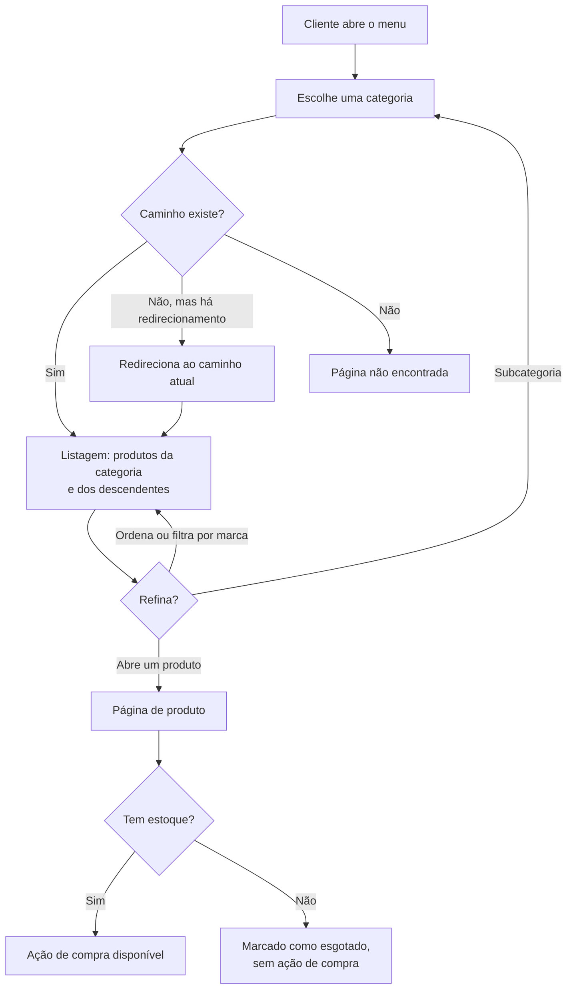
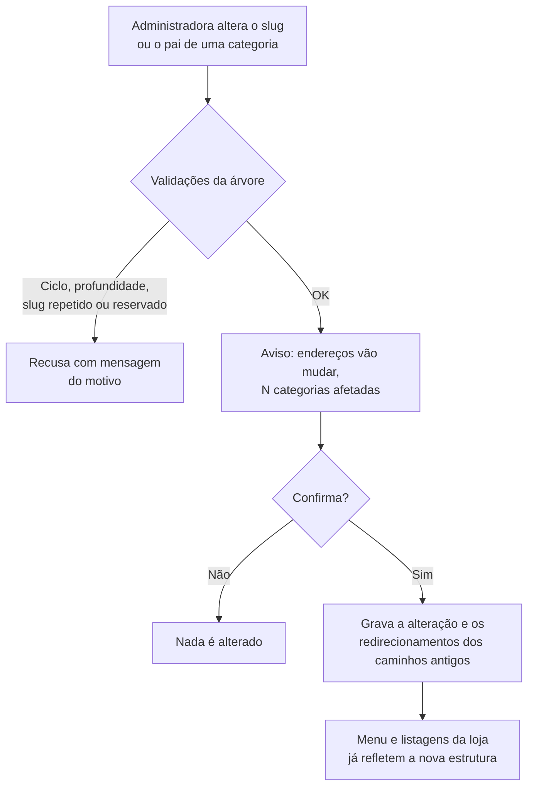
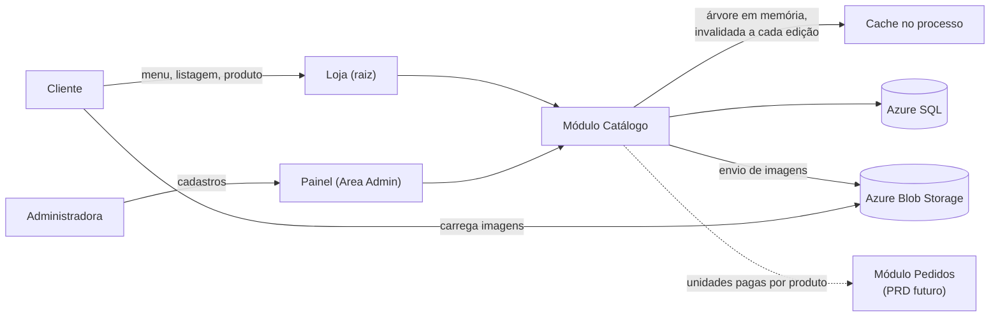

# PRD: Catálogo e navegação por categorias

**Cliente/Produto:** Flora Bambini (e-commerce local)
**Tipo:** Epic
**Autor:** Michel Banagouro
**Data:** 2026-10-09
**Status:** Aprovado

---

## 1. Visão geral

Este PRD cobre o catálogo da loja: o cadastro de categorias, marcas e produtos no painel administrativo, e a vitrine pública em que a cliente navega pelas categorias até a página de um produto. A loja não tem busca textual, então a árvore de categorias é o único caminho até o produto. O PRD termina na página de produto: adicionar ao carrinho, checkout, pedido e a home ficam em PRDs próprios.

## 2. Problema e contexto

**Problema:** o catálogo hoje é uma planilha Excel enviada por WhatsApp. Ela não mostra foto em tamanho decente, não descreve o produto, não informa se há unidade disponível e só pode ser atualizada reenviando o arquivo (proposta arquitetural, §2.1).

**Contexto atual:** a cliente pede o catálogo, recebe a planilha e responde com a lista do que quer. Preço e disponibilidade vivem na cabeça da vendedora e na planilha. Não há sistema.

**Impacto de não fazer:** sem catálogo não há o que colocar no carrinho; todos os demais PRDs da loja dependem deste. Do lado do negócio, a planilha continuaria sendo a fonte de verdade e a vendedora continuaria sendo o gargalo de cada venda.

## 3. Objetivo

Permitir que a administradora mantenha sozinha categorias, marcas e produtos pelo painel, e que a cliente encontre qualquer produto navegando pelas categorias, vendo foto, descrição, preço e disponibilidade.

### Métricas de sucesso

- Todo o catálogo da planilha atual cadastrado e publicado sem intervenção do desenvolvedor.
- Qualquer produto ativo alcançável a partir do menu em até 3 cliques (limite de profundidade da RN-05).
- Nenhuma alteração de preço, foto, estoque ou estrutura de categorias exigindo publicação da aplicação (§3.4 da proposta).

## 4. Escopo

### 4.1. Dentro do escopo

- Painel: cadastro, edição, movimentação e exclusão de categorias em árvore.
- Painel: cadastro, edição e exclusão de marcas.
- Painel: cadastro e edição de produtos, com galeria de imagens, preço normal e promocional, estoque e ativação.
- Loja: menu de categorias, página de listagem por categoria com ordenação e filtro de marca.
- Loja: página de produto.
- Redirecionamento permanente de endereços antigos de categoria e de produto.

### 4.2. Fora do escopo

- **Adicionar ao carrinho, carrinho e checkout** — PRD próprio (ADR-008). Este PRD só define quando a ação de compra aparece ou não na página de produto.
- **Baixa e devolução de estoque por pedido** — PRD de pedidos (ADR-007). Aqui o estoque só é editado manualmente no painel.
- **Home, banners e curadoria de destaques** — módulo de Conteúdo, PRD próprio.
- **Login da administradora** — PRD de autenticação (ADR-004). Este PRD assume que a área do painel já exige o perfil `Admin`.
- **Busca textual** — não-objetivo da proposta (§2.3).
- **Variações de produto** (tamanho, fragrância, volume) — cada combinação é um produto próprio, com preço e estoque próprios.
- **Preço promocional com vigência por data** — descartado nesta entrega; o preço promocional vale enquanto estiver preenchido.
- **Ordem manual de produtos na listagem** — substituída pelas ordenações da RN-28.
- **Exclusão de produto** — tirar um item de linha é inativar (RN-23).
- **Página ou URL própria de marca** — marca é filtro dentro da categoria (ADR-010).
- **Produto em mais de uma categoria** (ADR-010).
- **Carga inicial a partir da planilha Excel** — tratada no plano de execução (proposta, §12).
- **Campos fiscais** (NCM, CFOP) e **campos de SEO editáveis** (título e descrição de página).

## 5. Personas e usuários impactados

| Persona | Papel | Como interage com a feature |
|---------|-------|----------------------------|
| Administradora | A vendedora, única usuária do painel (perfil `Admin`) | Monta a árvore de categorias, cadastra marcas e produtos, sobe fotos, ajusta preço e estoque, ativa e inativa produtos |
| Cliente | Compradora da cidade, anônima ou identificada | Navega pelo menu, abre categorias, ordena, filtra por marca e abre a página de produto |

## 6. Hierarquia de entrega

- **Epic:** Catálogo e navegação por categorias
  - **Feature:** Gestão de categorias no painel
    - **PBI:** Criar e editar categoria (nome, slug, pai, posição) com validações da árvore
    - **PBI:** Mover categoria, com aviso de impacto e redirecionamento dos endereços antigos
    - **PBI:** Excluir categoria vazia e exibir a árvore com contagem de produtos por nó
  - **Feature:** Gestão de marcas no painel
    - **PBI:** Criar, editar e excluir marca
  - **Feature:** Gestão de produtos no painel
    - **PBI:** Criar e editar produto (dados, categoria, marca, preço, preço promocional, estoque)
    - **PBI:** Descrição formatada com sanitização
    - **PBI:** Galeria de imagens ordenada, com geração das versões grande, média, mini e thumb
    - **PBI:** Ativar e inativar produto; listagem de produtos no painel
  - **Feature:** Vitrine
    - **PBI:** Menu de categorias
    - **PBI:** Listagem por categoria com produtos dos descendentes, breadcrumb e subcategorias
    - **PBI:** Ordenação e filtro de marca na listagem
    - **PBI:** Carregamento da listagem por rolagem infinita, com link de próxima página
    - **PBI:** Página de produto
    - **PBI:** Redirecionamento de endereços antigos e resposta de não encontrado

> Esta é uma sugestão de quebra. O Product Owner pode reorganizar conforme prioridade e capacidade do time.
>
> **PBI não é `T-XX`.** O PBI é unidade de backlog; a tarefa do plano de execução é menor e sai da decomposição feita pelo `planner-leanwork`.

## 7. Fluxos

### 7.1. Fluxo principal — cliente navega até um produto



1. A cliente abre o menu, que mostra a árvore de categorias (RN-24).
2. Ao escolher uma categoria, a loja resolve o caminho da URL (RN-25). Caminho antigo redireciona ao atual (RN-08).
3. A listagem mostra os produtos ativos da categoria e de todos os descendentes (RN-26), com breadcrumb e links para as subcategorias (RN-27).
4. A cliente pode descer para uma subcategoria, trocar a ordenação (RN-28) ou filtrar por marca (RN-30).
5. Ao abrir um produto, vê a página dele (RN-32). Sem estoque, o produto aparece como esgotado e sem ação de compra (RN-33).

### 7.2. Fluxo do painel — mover ou renomear o endereço de uma categoria



### 7.3. Fluxos alternativos / de erro

- **Categoria sem produtos ativos:** a página existe e mostra uma mensagem de que ainda não há produtos ali; a categoria não aparece no menu (RN-24).
- **Produto inativo acessado por link direto:** responde como não encontrado (RN-34).
- **Exclusão de categoria com filhas ou produtos:** recusada, com o motivo (RN-07).
- **Exclusão de marca em uso:** recusada, informando quantos produtos a usam (RN-13).
- **Dois salvamentos concorrentes do mesmo produto:** o segundo é recusado sem sobrescrever, e o painel pede para recarregar (RN-19).
- **Imagem fora do formato, acima de 1 MB, menor que 1000 × 1000 px ou além do limite da galeria:** envio recusado com o motivo; as imagens já existentes não são afetadas (RN-21).
- **Fim da listagem:** quando não há mais lotes, a rolagem deixa de carregar (RN-37).

## 8. Regras de negócio

### Categorias

- **RN-01:** Uma categoria tem nome, slug, categoria pai opcional e posição entre as irmãs. Categoria sem pai é raiz; as linhas `Flora` e `Bambini` são categorias raiz, não um tipo diferente de entidade. *(ADR-010)*
- **RN-02:** O slug é único entre categorias irmãs (mesmo pai; as raízes entre si). O mesmo slug pode existir sob pais diferentes — `cabelo` sob `flora` e sob `bambini`. *(ADR-010)*
- **RN-03:** Na criação, o slug é sugerido a partir do nome (minúsculas, sem acentos, espaços viram hífen) e pode ser editado. Alterar o nome de uma categoria existente não altera o slug. *(ADR-010)*
- **RN-04:** O slug de uma categoria raiz não pode coincidir com um endereço reservado pela aplicação (por exemplo `produto`, `admin`, `carrinho`, `checkout`, `conta`). A lista de reservados acompanha as rotas existentes.
- **RN-05:** A árvore tem profundidade máxima de **3 níveis** (raiz = nível 1), valor mantido em configuração. Criar ou mover uma categoria é recusado quando ela, ou o descendente mais fundo dela, passaria do limite. *(ADR-010)*
- **RN-06:** Uma categoria não pode ter como pai ela mesma nem um de seus descendentes. *(ADR-010)*
- **RN-07:** Categoria que tem filhas, ou que tem qualquer produto vinculado (ativo ou inativo), não pode ser excluída. *(ADR-010)*
- **RN-08:** Quando o caminho de uma categoria muda — por alteração de slug ou de pai —, o caminho antigo dela e de todos os descendentes passa a redirecionar de forma permanente para o caminho atual. Redirecionamentos anteriores são atualizados para apontar direto ao caminho atual, sem cadeia. Se um caminho antigo voltar a ser ocupado por uma categoria real, a categoria prevalece e o redirecionamento é descartado. *(ADR-010)*
- **RN-09:** Antes de gravar uma alteração que muda caminho, o painel avisa que os endereços vão mudar e informa quantas categorias são afetadas; a alteração só é gravada após confirmação. *(ADR-010)*
- **RN-10:** O painel exibe a árvore de categorias com a contagem de produtos ativos de cada nó, incluindo os dos descendentes. *(ADR-010)*
- **RN-11:** Qualquer alteração na árvore feita no painel aparece no menu e nas listagens da loja a partir da requisição seguinte. *(ADR-010)*

### Marcas

- **RN-12:** Uma marca tem nome, único sem distinguir maiúsculas de minúsculas e ignorando espaços nas pontas. *(ADR-010)*
- **RN-13:** Marca referenciada por qualquer produto (ativo ou inativo) não pode ser excluída.

### Produtos

- **RN-14:** Um produto tem obrigatoriamente nome, slug, exatamente uma categoria (de qualquer nível), uma marca, preço e estoque. Descrição e preço promocional são opcionais. *(ADR-010)*
- **RN-15:** O slug do produto é único em toda a loja, sugerido a partir do nome na criação e editável. Alterar o slug faz o endereço antigo redirecionar de forma permanente ao novo, com as mesmas regras de cadeia e de reocupação da RN-08.
- **RN-16:** O preço é maior que zero, em reais com duas casas decimais, tratado como valor exato. *(ADR-003)*
- **RN-17:** O preço promocional, quando preenchido, é maior que zero e menor que o preço. O **preço vigente** do produto é o promocional quando preenchido, e o preço caso contrário. Não há vigência por data: a promoção começa ao preencher o campo e termina ao esvaziá-lo.
- **RN-18:** O estoque é um número inteiro maior ou igual a zero, editável no painel.
- **RN-19:** Se o produto foi alterado por outra operação depois que o formulário foi aberto, o salvamento é recusado sem sobrescrever nada, e o painel informa que os dados mudaram e precisam ser recarregados. *(ADR-007)*
- **RN-20:** A descrição aceita texto formatado limitado a parágrafos, negrito, itálico, listas e links. Qualquer outro conteúdo é removido ao salvar, e o que a loja exibe é sempre o conteúdo já saneado.
- **RN-21:** Um produto tem uma galeria de até **8 imagens**. Cada imagem enviada deve estar em JPG, PNG ou WebP, ter até **1 MB** e pelo menos **1000 × 1000 px**. Arquivo fora desse padrão é recusado com o motivo, e a tela de envio exibe a recomendação de formato, peso e dimensão. A ordem é definida no painel e a primeira imagem é a capa usada nas listagens. *(ADR-002)*
- **RN-36:** De cada imagem enviada o sistema guarda quatro versões quadradas: **grande** (1000 × 1000), **média** (500 × 500), **mini** (250 × 250) e **thumb** (100 × 100). Imagem que não é quadrada é cortada ao centro; imagem maior que 1000 px é reduzida. A loja usa a mini no card da listagem, a média como imagem principal da página de produto, a thumb nas miniaturas da galeria e a grande na ampliação. Remover uma imagem da galeria remove as quatro versões do armazenamento. *(ADR-002)*
- **RN-22:** O produto é ativo ou inativo. Todo produto novo nasce inativo. Só é possível ativar um produto que tenha ao menos uma imagem, e não é possível remover a última imagem de um produto ativo.
- **RN-23:** Não existe exclusão de produto. Tirar um produto da loja é inativá-lo.

### Vitrine

- **RN-24:** O menu da loja mostra a árvore de categorias, com as irmãs na posição definida no painel. Categoria que não tem produto ativo nela nem em nenhum descendente não aparece no menu.
- **RN-25:** O endereço de uma categoria é o caminho de slugs da raiz até ela (`/flora/cabelo/shampoo`). Caminho que não corresponde a uma categoria nem a um redirecionamento responde como não encontrado. *(ADR-010)*
- **RN-26:** A listagem de uma categoria mostra os produtos ativos vinculados a ela e a todos os seus descendentes. *(ADR-010)*
- **RN-27:** A página de categoria mostra o breadcrumb do caminho e links para as categorias filhas diretas que tenham produto ativo.
- **RN-28:** A listagem oferece três ordenações: **Mais vendidos** (padrão) — total de unidades do produto em pedidos pagos, desde sempre, do maior para o menor; **Novos** — data de cadastro, do mais recente para o mais antigo; **Menor preço** — preço vigente, do menor para o maior. Empate resolve pelo cadastro mais recente e, persistindo, pelo nome.
- **RN-29:** Em qualquer ordenação, produtos esgotados (estoque zero) aparecem depois de todos os produtos disponíveis.
- **RN-30:** A listagem oferece filtro por marca com as marcas presentes entre os produtos ativos daquela listagem. A cliente pode selecionar uma ou mais marcas, e o filtro combina com a ordenação. O filtro não cria endereço próprio: a página filtrada declara como endereço canônico o da categoria sem filtro. *(ADR-010)*
- **RN-37:** A listagem é carregada em lotes de **12 produtos**: o primeiro lote vem com a página e os seguintes são carregados automaticamente quando a cliente rola até o fim, até acabarem os produtos. Os lotes respeitam a ordenação e o filtro de marca ativos, e nenhum produto se repete ou é pulado entre lotes. Cada lote também tem endereço próprio, alcançável por um link de próxima página presente no conteúdo, de modo que todos os produtos sejam acessíveis sem JavaScript e por buscadores. *(ADR-001)*
- **RN-31:** Cada produto na listagem mostra capa, nome, marca e preço. Com preço promocional, mostra o preço normal riscado e o promocional em destaque. Produto esgotado recebe a marcação "Esgotado".
- **RN-32:** A página de produto fica em `/produto/{slug}` e mostra galeria, nome, marca, preço (com a mesma regra da RN-31), descrição, breadcrumb da categoria do produto e disponibilidade. A quantidade em estoque não é exibida à cliente.
- **RN-33:** Produto ativo com estoque zero continua nas listagens e com a página acessível, marcado como esgotado e sem ação de compra.
- **RN-34:** Produto inativo não aparece em listagem, não conta para o menu (RN-24), para as contagens (RN-10) nem para o filtro de marca (RN-30), e sua página responde como não encontrada.

### Acesso

- **RN-35:** Todas as telas e ações do painel exigem usuário autenticado com perfil `Admin`. A vitrine é pública e não exige identificação. *(ADR-001, ADR-004)*

## 9. Critérios de aceite

```gherkin
#language: pt
Funcionalidade: Gestão de categorias no painel

  Cenário [CA-01]: Criar categoria raiz com slug sugerido
    Dado que a administradora está no cadastro de categorias
    Quando ela cria a categoria "Flora" sem categoria pai
    Então a categoria é gravada como raiz com o slug "flora" (RN-01, RN-03)
    E ela aparece na árvore do painel com contagem de 0 produtos (RN-10)

  Cenário [CA-02]: Mesmo slug sob pais diferentes
    Dado que existe a categoria "Cabelo" com slug "cabelo" sob "Flora"
    Quando a administradora cria "Cabelo" com slug "cabelo" sob "Bambini"
    Então a categoria é gravada (RN-02)

  Cenário [CA-03]: Slug repetido entre irmãs é recusado
    Dado que existe a categoria "Cabelo" com slug "cabelo" sob "Flora"
    Quando a administradora cria outra categoria com slug "cabelo" sob "Flora"
    Então o painel recusa e informa que já existe categoria com esse endereço nesse nível (RN-02)

  Cenário [CA-04]: Slug reservado em categoria raiz é recusado
    Quando a administradora cria uma categoria raiz com slug "produto"
    Então o painel recusa e informa que o endereço é reservado pela loja (RN-04)

  Cenário [CA-05]: Renomear não muda o endereço
    Dado que existe a categoria "Cabelo" com slug "cabelo" sob "Flora"
    Quando a administradora altera o nome para "Cabelos" sem tocar no slug
    Então o endereço da categoria continua "/flora/cabelo" (RN-03)
    E nenhum redirecionamento é criado (RN-08)

  Cenário [CA-06]: Criar categoria além da profundidade máxima
    Dado que existe o caminho "Flora > Cabelo > Shampoo"
    Quando a administradora cria uma categoria com pai "Shampoo"
    Então o painel recusa e informa o limite de 3 níveis (RN-05)

  Cenário [CA-07]: Mover subárvore que estouraria a profundidade
    Dado que existe o caminho "Flora > Cabelo > Shampoo"
    E existe o caminho "Bambini > Banho"
    Quando a administradora move "Cabelo" para dentro de "Banho"
    Então o painel recusa, porque "Shampoo" ficaria no nível 4 (RN-05)

  Cenário [CA-08]: Mover categoria para dentro de um descendente
    Dado que existe o caminho "Flora > Cabelo > Shampoo"
    Quando a administradora define "Shampoo" como pai de "Cabelo"
    Então o painel recusa e informa que uma categoria não pode ficar dentro dela mesma (RN-06)

  Cenário [CA-09]: Mover categoria avisa o impacto e redireciona os endereços antigos
    Dado que existe o caminho "Flora > Cabelo > Shampoo"
    Quando a administradora move "Cabelo" para dentro de "Bambini"
    Então o painel avisa que os endereços vão mudar e que 2 categorias são afetadas (RN-09)
    Quando ela confirma
    Então "/flora/cabelo" redireciona de forma permanente para "/bambini/cabelo" (RN-08)
    E "/flora/cabelo/shampoo" redireciona de forma permanente para "/bambini/cabelo/shampoo" (RN-08)

  Cenário [CA-10]: Cancelar o aviso não altera nada
    Dado que a administradora alterou o slug de "Cabelo" e o painel exibiu o aviso de impacto
    Quando ela cancela
    Então o slug e o endereço da categoria permanecem os anteriores (RN-09)

  Cenário [CA-11]: Duas mudanças seguidas não formam cadeia de redirecionamento
    Dado que o slug de "Cabelo" sob "Flora" mudou de "cabelo" para "cabelos"
    Quando a administradora muda o slug de "cabelos" para "capilar"
    Então "/flora/cabelo" redireciona direto para "/flora/capilar" (RN-08)
    E "/flora/cabelos" redireciona direto para "/flora/capilar" (RN-08)

  Cenário [CA-12]: Categoria nova em caminho antigo prevalece sobre o redirecionamento
    Dado que "/flora/cabelo" redireciona para "/flora/capilar"
    Quando a administradora cria uma categoria com slug "cabelo" sob "Flora"
    Então "/flora/cabelo" passa a exibir a categoria nova (RN-08)

  Esquema do Cenário [CA-13]: Exclusão de categoria que não está vazia
    Dado que a categoria "Cabelo" tem <conteudo>
    Quando a administradora tenta excluí-la
    Então o painel recusa e informa o motivo (RN-07)

    Exemplos:
      | conteudo              |
      | uma categoria filha   |
      | um produto ativo      |
      | um produto inativo    |

  Cenário [CA-14]: Exclusão de categoria vazia
    Dado que a categoria "Acessórios" não tem filhas nem produtos
    Quando a administradora a exclui
    Então ela deixa de existir na árvore do painel e no menu da loja (RN-07, RN-11)

  Cenário [CA-15]: Contagem de produtos inclui descendentes e ignora inativos
    Dado que "Flora > Cabelo > Shampoo" tem 2 produtos ativos e 1 inativo
    E "Flora > Cabelo" tem 1 produto ativo vinculado diretamente
    Quando a administradora abre a árvore de categorias
    Então "Shampoo" mostra 2, "Cabelo" mostra 3 e "Flora" mostra 3 (RN-10, RN-34)

  Cenário [CA-16]: Alteração da árvore aparece na loja em seguida
    Dado que a categoria "Corpo" sob "Flora" tem um produto ativo
    Quando a administradora altera o nome para "Corpo e banho"
    E uma cliente carrega qualquer página da loja
    Então o menu mostra "Corpo e banho" (RN-11)

Funcionalidade: Gestão de marcas no painel

  Cenário [CA-17]: Nome de marca repetido é recusado
    Dado que existe a marca "Verde Vida"
    Quando a administradora cria a marca " verde vida "
    Então o painel recusa e informa que a marca já existe (RN-12)

  Cenário [CA-18]: Exclusão de marca em uso
    Dado que a marca "Verde Vida" é usada por 3 produtos
    Quando a administradora tenta excluí-la
    Então o painel recusa e informa que 3 produtos usam a marca (RN-13)

Funcionalidade: Gestão de produtos no painel

  Cenário [CA-19]: Criar produto nasce inativo
    Dado que existem a categoria "Flora > Cabelo > Shampoo" e a marca "Verde Vida"
    Quando a administradora cria o produto "Shampoo de Camomila" com preço 42,90 e estoque 5
    Então o produto é gravado inativo com o slug "shampoo-de-camomila" (RN-14, RN-15, RN-22)
    E ele não aparece na loja (RN-34)

  Esquema do Cenário [CA-20]: Campos obrigatórios e limites do produto
    Quando a administradora salva um produto com <situacao>
    Então o painel recusa e aponta o campo <campo> (<regra>)

    Exemplos:
      | situacao                                  | campo             | regra |
      | nenhuma categoria                         | categoria         | RN-14 |
      | nenhuma marca                             | marca             | RN-14 |
      | preço 0,00                                | preço             | RN-16 |
      | preço 40,00 e preço promocional 40,00     | preço promocional | RN-17 |
      | preço 40,00 e preço promocional 45,00     | preço promocional | RN-17 |
      | estoque -1                                | estoque           | RN-18 |
      | slug já usado por outro produto           | slug              | RN-15 |

  Cenário [CA-21]: Ativar produto sem imagem é recusado
    Dado que o produto "Shampoo de Camomila" está inativo e sem imagens
    Quando a administradora tenta ativá-lo
    Então o painel recusa e informa que é preciso ao menos uma imagem (RN-22)

  Cenário [CA-22]: Remover a última imagem de produto ativo é recusado
    Dado que o produto "Shampoo de Camomila" está ativo e tem uma única imagem
    Quando a administradora tenta remover essa imagem
    Então o painel recusa e informa que produto ativo precisa de ao menos uma imagem (RN-22)

  Esquema do Cenário [CA-23]: Envio de imagem inválida
    Dado que o produto tem <existentes> imagens
    Quando a administradora envia <arquivo>
    Então o painel recusa o envio e informa o motivo (RN-21)
    E a galeria continua com <existentes> imagens

    Exemplos:
      | existentes | arquivo                                    |
      | 2          | um arquivo PDF                             |
      | 2          | uma imagem JPG de 2 MB e 1000 × 1000 px    |
      | 2          | uma imagem JPG de 300 KB e 800 × 800 px    |
      | 8          | uma imagem PNG de 500 KB e 1000 × 1000 px  |

  Cenário [CA-44]: Envio de imagem gera as quatro versões
    Dado um produto sem imagens
    Quando a administradora envia uma imagem JPG de 800 KB e 1200 × 1000 px
    Então a galeria passa a ter 1 imagem (RN-21)
    E existem as versões de 1000 × 1000, 500 × 500, 250 × 250 e 100 × 100, cortadas ao centro (RN-36)

  Cenário [CA-45]: Remover imagem remove todas as versões
    Dado um produto inativo com 2 imagens
    Quando a administradora remove uma delas
    Então as quatro versões dessa imagem deixam de existir no armazenamento (RN-36)
    E a outra imagem permanece com suas quatro versões

  Cenário [CA-24]: Reordenar a galeria troca a capa
    Dado que o produto tem as imagens "frente" e "verso", nessa ordem
    Quando a administradora move "verso" para a primeira posição
    Então a listagem da loja passa a usar "verso" como capa do produto (RN-21)

  Cenário [CA-25]: Descrição é saneada ao salvar
    Quando a administradora salva uma descrição contendo um trecho em negrito, uma lista e um script
    Então o negrito e a lista são mantidos (RN-20)
    E o script não é gravado nem aparece na página do produto (RN-20)

  Cenário [CA-26]: Salvamento concorrente não sobrescreve
    Dado que a administradora abriu o formulário do produto com estoque 5
    E o estoque do produto foi alterado para 4 por outra operação
    Quando ela salva o formulário com estoque 10
    Então o painel recusa e informa que os dados mudaram e precisam ser recarregados (RN-19)
    E o estoque do produto continua 4

  Cenário [CA-27]: Alterar o slug do produto redireciona o endereço antigo
    Dado que o produto ativo tem o slug "shampoo-de-camomila"
    Quando a administradora altera o slug para "shampoo-camomila-200ml"
    Então "/produto/shampoo-de-camomila" redireciona de forma permanente para "/produto/shampoo-camomila-200ml" (RN-15)

  Cenário [CA-28]: Não há exclusão de produto
    Quando a administradora abre a edição ou a listagem de produtos no painel
    Então não existe ação de excluir produto, apenas de ativar e inativar (RN-23)

Funcionalidade: Vitrine

  Cenário [CA-29]: Categoria sem produto ativo não aparece no menu
    Dado que "Flora > Casa" tem apenas produtos inativos
    E "Flora > Cabelo > Shampoo" tem um produto ativo
    Quando a cliente abre o menu
    Então "Flora" e "Cabelo" aparecem (RN-24)
    E "Casa" não aparece (RN-24, RN-34)

  Cenário [CA-30]: Listagem da categoria pai inclui os descendentes
    Dado que "Flora > Cabelo > Shampoo" tem o produto ativo "Shampoo de Camomila"
    E "Flora > Corpo" tem o produto ativo "Óleo de Amêndoas"
    Quando a cliente abre "/flora"
    Então a listagem mostra "Shampoo de Camomila" e "Óleo de Amêndoas" (RN-26)
    E a página mostra links para "Cabelo" e "Corpo" (RN-27)

  Cenário [CA-31]: Breadcrumb e subcategorias na categoria intermediária
    Dado que "Flora > Cabelo" tem as filhas "Shampoo", com produto ativo, e "Condicionador", sem produtos
    Quando a cliente abre "/flora/cabelo"
    Então o breadcrumb mostra "Flora > Cabelo" (RN-27)
    E a página mostra link para "Shampoo" e não mostra link para "Condicionador" (RN-27)

  Cenário [CA-32]: Categoria existente sem produtos ativos
    Dado que "Flora > Casa" não tem produto ativo
    Quando a cliente abre "/flora/casa"
    Então a página informa que ainda não há produtos nessa categoria (RN-26)

  Cenário [CA-33]: Caminho inexistente
    Quando a cliente abre "/flora/nao-existe"
    Então a loja responde como página não encontrada (RN-25)

  Cenário [CA-34]: Ordenação padrão por mais vendidos, com esgotados no fim
    Dado os produtos ativos da categoria:
      | produto | unidades pagas | estoque |
      | A       | 10             | 0       |
      | B       | 7              | 3       |
      | C       | 2              | 5       |
    Quando a cliente abre a listagem sem escolher ordenação
    Então os produtos aparecem na ordem B, C, A (RN-28, RN-29)

  Cenário [CA-35]: Sem vendas, mais vendidos cai no mais recente
    Dado que nenhum produto da categoria tem unidades pagas
    E "B" foi cadastrado depois de "A"
    Quando a cliente abre a listagem sem escolher ordenação
    Então "B" aparece antes de "A" (RN-28)

  Cenário [CA-36]: Menor preço usa o preço vigente
    Dado os produtos ativos e disponíveis:
      | produto | preço | preço promocional |
      | A       | 50,00 | 30,00             |
      | B       | 35,00 |                   |
    Quando a cliente ordena por "Menor preço"
    Então "A" aparece antes de "B" (RN-17, RN-28)

  Cenário [CA-37]: Ordenação por novos
    Dado que "B" foi cadastrado depois de "A" e ambos têm estoque
    Quando a cliente ordena por "Novos"
    Então "B" aparece antes de "A" (RN-28)

  Cenário [CA-38]: Filtro de marca combinado com ordenação
    Dado que a listagem de "Flora" tem produtos ativos das marcas "Verde Vida" e "Raiz"
    E existe a marca "Aurora", sem produto ativo em "Flora"
    Quando a cliente abre "/flora"
    Então o filtro oferece "Verde Vida" e "Raiz" e não oferece "Aurora" (RN-30)
    Quando ela seleciona "Raiz" e ordena por "Menor preço"
    Então a listagem mostra só produtos da marca "Raiz", do menor para o maior preço vigente (RN-28, RN-30)
    E a página declara "/flora" como endereço canônico (RN-30)

  Cenário [CA-46]: Rolagem carrega os lotes seguintes na mesma ordem
    Dado que a listagem de "Flora" tem 30 produtos ativos
    Quando a cliente abre "/flora" e ordena por "Menor preço"
    Então a página mostra os 12 produtos de menor preço vigente (RN-37)
    Quando ela rola até o fim da listagem duas vezes
    Então a página passa a mostrar os 30 produtos, sem repetição, do menor para o maior preço vigente (RN-28, RN-37)
    E rolar novamente não carrega mais nada (RN-37)

  Cenário [CA-47]: Listagem navegável sem JavaScript
    Dado que a listagem de "Flora" tem 30 produtos ativos
    Quando um visitante sem JavaScript abre "/flora"
    Então a página mostra 12 produtos e um link de próxima página (RN-37)
    E seguindo os links de próxima página ele alcança os 30 produtos (RN-37)

  Cenário [CA-39]: Preço promocional na listagem e na página de produto
    Dado um produto ativo com preço 50,00 e preço promocional 39,90
    Quando a cliente vê o produto na listagem ou abre a página dele
    Então o preço 50,00 aparece riscado e 39,90 aparece em destaque (RN-31, RN-32)

  Cenário [CA-40]: Página de produto disponível
    Dado o produto ativo "Shampoo de Camomila", com estoque 5, em "Flora > Cabelo > Shampoo"
    Quando a cliente abre "/produto/shampoo-de-camomila"
    Então a página mostra galeria, nome, marca, preço e descrição (RN-32)
    E o breadcrumb mostra "Flora > Cabelo > Shampoo" (RN-32)
    E a ação de compra está disponível
    E a quantidade 5 não é exibida (RN-32)

  Cenário [CA-41]: Produto esgotado
    Dado o produto ativo "Shampoo de Camomila" com estoque 0
    Quando a cliente o vê na listagem e abre a página dele
    Então ele aparece marcado como "Esgotado" nos dois lugares (RN-31, RN-33)
    E a página não oferece ação de compra (RN-33)

  Cenário [CA-42]: Produto inativo por link direto
    Dado o produto inativo com slug "shampoo-de-camomila"
    Quando a cliente abre "/produto/shampoo-de-camomila"
    Então a loja responde como página não encontrada (RN-34)

Funcionalidade: Acesso ao painel

  Esquema do Cenário [CA-43]: Painel de catálogo exige perfil Admin
    Dado um visitante <situacao>
    Quando ele tenta abrir ou enviar dados a qualquer tela de categorias, marcas ou produtos do painel
    Então o acesso é negado e nada é alterado (RN-35)

    Exemplos:
      | situacao                            |
      | não autenticado                     |
      | autenticado com perfil Cliente      |
```

## 10. Permissionamento

| Ação | Perfis autorizados | Observação |
|------|-------------------|------------|
| Navegar no menu, listagens e página de produto | Qualquer visitante | Sem identificação (RN-35) |
| Criar, editar, mover e excluir categorias | `Admin` | Política aplicada à área do painel inteira (ADR-004) |
| Criar, editar e excluir marcas | `Admin` | — |
| Criar e editar produtos, gerenciar galeria, ativar e inativar | `Admin` | Não há exclusão (RN-23) |

## 11. Integrações e dados

### 11.1. Sistemas envolvidos

- **Azure Blob Storage** — armazenamento das quatro versões de cada imagem de produto (RN-36); envio pela aplicação, leitura por URL pública direto do navegador (ADR-002).
- **Módulo de Pedidos (interno)** — fonte do total de unidades pagas por produto para a ordenação "Mais vendidos" (RN-28). Ainda não existe; ver seção 15.

### 11.2. Dados consumidos

- Total de unidades por produto em pedidos pagos (módulo de Pedidos).
- Profundidade máxima da árvore e limites de imagem (configuração).

### 11.3. Dados produzidos / persistidos

- Categorias (árvore), marcas, produtos e imagens de produto com sua ordem — Azure SQL (ADR-002).
- Arquivos de imagem — Azure Blob Storage.
- Redirecionamentos de endereços antigos de categoria e de produto — Azure SQL.

## 13. Arquitetura técnica



A árvore de categorias é lida em memória e invalidada quando o painel a edita (ADR-010); é o que sustenta a RN-11 sem consulta recursiva a cada página.

## 14. Restrições e premissas

- **Restrição:** stack e infraestrutura conforme a proposta arquitetural (ADR-001, ADR-002); nenhum recurso de nuvem novo.
- **Restrição:** sem busca textual (§2.3) — a navegação por categoria precisa bastar.

> ⚠️ **Premissa:** o limite de 8 imagens por produto e os formatos JPG/PNG/WebP (RN-21) são valores de partida. O teto de 1 MB e a imagem grande de 1000 × 1000 foram definidos pelo Michel.

> ⚠️ **Premissa:** imagem não quadrada é cortada ao centro (RN-36). A orientação à administradora é enviar a foto já quadrada, em 1000 × 1000 px e até 1 MB; o painel deve exibir essa recomendação junto ao envio.

> ⚠️ **Premissa:** cada lote da rolagem infinita tem endereço próprio com link de próxima página (RN-37). O link existe porque a proposta trata a indexação por buscadores como aquisição de cliente (ADR-001), e conteúdo carregado só por rolagem não é indexado.

> ⚠️ **Premissa:** exigir ao menos uma imagem para ativar o produto (RN-22) e esconder do menu a categoria sem produto ativo (RN-24) não foram discutidos; foram adotados para que a vitrine nunca mostre produto sem foto nem leve a página vazia.

> ⚠️ **Premissa:** a cliente não vê a quantidade em estoque, só disponível ou esgotado (RN-32).

> ⚠️ **Premissa:** o filtro de marca aceita mais de uma marca ao mesmo tempo (RN-30).

> ⚠️ **Premissa:** alterar o slug de um produto também gera redirecionamento permanente (RN-15), por analogia com o que o ADR-010 exige para categoria.

## 15. Riscos e dependências

| Tipo | Descrição | Mitigação / Plano |
|------|-----------|-------------------|
| Dependência | A ordenação "Mais vendidos" (RN-28) precisa do total de unidades pagas, que só existirá com o PRD de pedidos | Até lá o total é zero para todos e a ordenação cai no desempate por mais recente (CA-35). A regra já fica definida aqui; a fonte do dado é ligada quando Pedidos existir |
| Dependência | O painel exige perfil `Admin` (RN-35), e o login da administradora pertence ao PRD de autenticação | O plano precisa ordenar a autenticação do painel antes, ou junto, das telas deste PRD |
| Dependência | A ação de compra da página de produto pertence ao PRD de carrinho | Este PRD entrega apenas a regra de quando a ação aparece (RN-33) |
| Risco | A árvore virar labirinto de categorias com um ou dois produtos (dívida registrada na proposta, §9) | Limite de 3 níveis (RN-05), contagem por nó no painel (RN-10) e categorias vazias fora do menu (RN-24) |
| Risco | Reorganizar categorias quebra endereços já indexados (proposta, §10) | Slug independente do nome (RN-03), aviso antes de confirmar (RN-09), redirecionamento permanente (RN-08) |
| Risco | "Salvei e o menu não mudou" por falha de invalidação do cache da árvore (ADR-010) | RN-11 com cenário próprio (CA-16); toda operação do painel que toca a árvore precisa ser coberta |
| Risco | Descrição formatada abre porta para conteúdo ativo gravado pelo painel | Lista fechada de formatação e saneamento ao salvar (RN-20, CA-25) |
| Risco | Gerar quatro versões de cada imagem consome CPU e memória da única instância, que também atende a loja (ADR-002, ADR-006) | Teto de 1 MB por arquivo e de 8 imagens por produto (RN-21); o envio é ação rara e feita só pela administradora |
| Risco | Rolagem infinita esconde produtos de buscadores e de quem navega sem JavaScript | Cada lote tem endereço próprio e link de próxima página (RN-37, CA-47) |
| Risco | Promoção esquecida ligada, já que não há data de término (RN-17) | Aceito nesta entrega; a listagem de produtos do painel deve deixar visível quais têm preço promocional |

## 16. Questões em aberto

Todas respondidas pelo Michel em 2026-10-09:

- [x] Qual é a árvore real de `Flora` e `Bambini`? — `Flora` e `Bambini` são as duas categorias raiz. As subcategorias, inclusive a de limpeza, são cadastro feito pela administradora no painel, não requisito deste PRD.
- [x] As fotos atuais atendem a 1000 × 1000 px e 1 MB? — a orientação é que a foto já chegue no padrão. O sistema não trata foto fora dele: recusa e informa o motivo (RN-21).
- [x] As dimensões de média, mini e thumb (RN-36) e o lote de 12 da rolagem (RN-37) valem? — sim.
- [x] Existe produto sem marca? — não. Marca é obrigatória (RN-14).

## 17. Referências

- Proposta arquitetural: `docs/architecture/proposta-arquitetural.md` (v0.5) — em especial §2.3, §3.4, ADR-001, ADR-002, ADR-007 e ADR-010.
