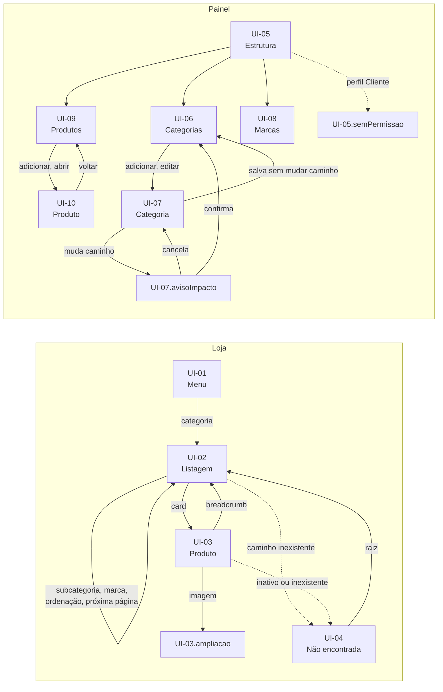

# SPEC-UI-001: Catálogo e navegação por categorias

> **PRD de referência:** `docs/prds/PRD-001-catalogo-e-categorias.md`
> **Arquitetura de referência:** `docs/architecture/proposta-arquitetural.md` (v0.5)
> **Modo:** Híbrido — vitrine indexada a partir de `docs/design/`; painel gerado
> **Artefato visual:** `docs/prototype/prototipo-001/loja.html` (vitrine) e `docs/prototype/prototipo-001/admin.html` (painel). Design de referência da vitrine: `docs/design/`
> **Fidelidade:** Alta fidelidade. A vitrine herda o sistema visual de `docs/design/styles.css`; o painel segue o padrão de painel administrativo do Shopify, pedido pelo Michel
> **Autor:** Michel Banagouro
> **Data:** 2026-10-11
> **Status:** Aprovado

Cada estado abre direto pelo endereço: `admin.html#UI-07.avisoImpacto`, `loja.html#UI-02.semJs`. A barra escura no canto inferior do protótipo troca tela e estado e não faz parte da interface.

---

## 1. Contexto de interface

**Arquétipo:** E-commerce na vitrine (UI-01 a UI-04); Admin na área do painel (UI-05 a UI-10).

**Dispositivo alvo:** Responsivo pleno na vitrine (proposta, §2.3: "site responsivo apenas"). Painel pensado para desktop, utilizável em celular.

**Stack de frontend:** ASP.NET Core MVC (.NET 10) com views Razor renderizadas no servidor, sem SPA; JavaScript só em interações pontuais (ADR-001). O design de referência é um protótipo em React com Babel no navegador: serve de referência visual, não de base de código. O `styles.css` dele é CSS puro e pode ser reaproveitado como está.

**Origem das informações deste documento:**

| Fonte | O que veio dela |
|---|---|
| Protótipo (`docs/design/`) | Sistema visual da vitrine (tokens, tipografia, botões, chips, card de produto, cabeçalho, breadcrumb); estrutura da listagem em grade de 4 colunas; estrutura da página de produto (miniaturas, imagem principal, painel de informações) |
| PRD | Todas as telas do painel; menu em árvore; ordenação, filtro de marca e rolagem em lotes; estados de erro, vazio, esgotado e promoção; página não encontrada |
| Arquitetura | Stack, renderização no servidor, responsividade, ausência de busca, painel em `Area` sob o perfil `Admin` |
| Pedido do Michel (2026-10-11) | `docs/design` como referência da vitrine; painel no estilo do Shopify, limpo e com foco em usabilidade |

Na coluna **Origem** das tabelas de estado: **Protótipo** = observado em `docs/design`; **Gerado** = desenhado nesta fase a partir do PRD, sem validação visual prévia.

**O que o design de referência tem e ficou de fora desta SPEC-UI**, por pertencer a outro PRD ou a nenhum: home (`home.jsx`), gaveta de carrinho (`CartDrawer`), páginas "Ingredientes" e "Diário", painel de ajustes de paleta e tom. Ver itens 1 a 4 na seção 8.

---

## 2. Tokens de design

**Vitrine:** ver `docs/design/styles.css` — não duplicado aqui. O protótipo `loja.html` importa esse arquivo e só acrescenta regras para o que o design não tinha. Paleta em uso: `salvia`, a padrão do design (as variantes `oliva`, `eucalipto` e `musgo` existem só no painel de ajustes do design).

**Painel** (gerados, definidos em `admin.html`):

| Token | Valor | Origem |
|---|---|---|
| Fundo da página | `#f1f1f1` | Gerado (padrão Shopify) |
| Superfície de cartão | `#ffffff`, raio 12px | Gerado |
| Barra superior | `#1a1a1a` | Gerado |
| Navegação lateral | `#ebebeb` | Gerado |
| Texto / texto secundário | `#303030` / `#616161` | Gerado |
| Ação primária | `#303030` | Gerado |
| Crítico (texto / fundo) | `#8e1f0b` / `#fee9e8` | Gerado |
| Atenção (texto / fundo) | `#5e4200` / `#fff1e3` | Gerado |
| Sucesso (texto / fundo) | `#0c5132` / `#cdfee1` | Gerado |
| Foco | `#005bd3` | Gerado |
| Acento da marca (logo do painel) | `#5d7159` (`--sage-deep` da vitrine) | Protótipo |
| Fonte | Inter, 13px | Gerado |

---

## 3. Inventário de telas

| ID | Tela | Rota | Persona | Implementa (RN) | Valida (CA) |
|---|---|---|---|---|---|
| UI-01 | Cabeçalho e menu de categorias | todas as páginas da loja | Cliente | RN-11, RN-24, RN-34 | CA-14, CA-16, CA-29 |
| UI-02 | Listagem de categoria | `/{caminho-de-slugs}` | Cliente | RN-17, RN-25 a RN-31, RN-33, RN-34, RN-36, RN-37 | CA-24, CA-30 a CA-39, CA-41, CA-46, CA-47 |
| UI-03 | Página de produto | `/produto/{slug}` | Cliente | RN-17, RN-20, RN-31 a RN-33, RN-36 | CA-25, CA-39, CA-40, CA-41 |
| UI-04 | Página não encontrada | qualquer caminho sem categoria, produto ativo ou redirecionamento | Cliente | RN-25, RN-34 | CA-33, CA-42 |
| UI-05 | Estrutura do painel e acesso | `/admin/*` | Administradora | RN-35 | CA-43 |
| UI-06 | Árvore de categorias | `/admin/categorias` | Administradora | RN-01, RN-05, RN-07, RN-10, RN-11 | CA-01, CA-13, CA-14, CA-15 |
| UI-07 | Formulário de categoria | `/admin/categorias/nova`, `/admin/categorias/{id}` | Administradora | RN-01 a RN-06, RN-08, RN-09 | CA-01 a CA-12, CA-16 |
| UI-08 | Marcas | `/admin/marcas` | Administradora | RN-12, RN-13 | CA-17, CA-18 |
| UI-09 | Listagem de produtos | `/admin/produtos` | Administradora | RN-17, RN-22, RN-23 | CA-19, CA-21, CA-28 |
| UI-10 | Formulário de produto | `/admin/produtos/novo`, `/admin/produtos/{id}` | Administradora | RN-14 a RN-23, RN-36 | CA-19 a CA-28, CA-44, CA-45 |

As rotas da loja vêm do PRD (RN-25, RN-32). As rotas do painel são sugestão desta fase: o PRD só fixa que ficam na área do painel.

---

## 4. Telas em detalhe

### UI-01 — Cabeçalho e menu de categorias

**Propósito:** levar a cliente a qualquer categoria. Sem busca, é o único ponto de entrada do catálogo.

**Rota:** presente em todas as páginas da loja.

**Persona:** Cliente.

**Regras que se manifestam:**

| Regra | Como aparece na tela |
|---|---|
| RN-24 | Raízes na barra, na posição definida no painel; ao abrir uma raiz, o painel mostra o nível 2 como títulos e o nível 3 como lista. Categoria sem produto ativo nela nem nos descendentes não é renderizada |
| RN-11 | O menu é montado a cada requisição a partir da árvore atual; não há estado "desatualizado" a desenhar |
| RN-34 | Produto inativo não conta para manter uma categoria no menu |

**Estados:**

| Estado | ID | Quando ocorre | O que o usuário vê | Origem |
|---|---|---|---|---|
| Padrão | `UI-01.default` | Sempre | Faixa de avisos no topo; raízes à esquerda, logo ao centro, ícones de conta e carrinho à direita | Protótipo (estrutura); itens do menu: Gerado |
| Menu aberto | `UI-01.aberto` | Ponteiro ou foco sobre uma raiz | Painel de largura total com nível 2, nível 3 e o link "Ver tudo de {raiz}" | Gerado |
| Menu no celular | `UI-01.mobile` | Toque no botão de menu, em tela estreita | Gaveta lateral com a árvore inteira aberta e o link "Fechar" | Gerado |

**Elementos principais:**

- Raiz — link para a listagem da raiz; também abre o painel.
- Painel — cada categoria de nível 2 e 3 é um link para a sua listagem.
- Logo — link para a home (PRD próprio).
- Ícones de conta e carrinho — reservam o lugar; comportamento em outros PRDs.

**Navegação:**

- Qualquer categoria → `UI-02`

**Observações:** o design de referência tem cinco links fixos (Início, Bambini, Donna, Ingredientes, Diário) e um botão de busca. O menu em árvore substitui os links fixos, e a busca foi retirada por ser não-objetivo (§2.3). A faixa de avisos do topo foi mantida do design por decisão do Michel; os textos dela no protótipo ("Frete grátis acima de R$ 240…") são de exemplo, não correspondem a regra nenhuma e serão definidos pelo módulo de conteúdo. O menu abre por foco, não só por ponteiro, e precisa funcionar sem JavaScript, já que é o único caminho até o produto.

---

### UI-02 — Listagem de categoria

**Propósito:** mostrar os produtos de uma categoria e de seus descendentes, com refino por subcategoria, marca e ordenação.

**Rota:** `/{caminho-de-slugs}`, por exemplo `/flora/cabelo/shampoo`. Ordenação e marcas vão na query string; cada lote tem endereço próprio.

**Persona:** Cliente.

**Regras que se manifestam:**

| Regra | Como aparece na tela |
|---|---|
| RN-25 | Caminho inexistente e sem redirecionamento leva a `UI-04` |
| RN-26 | A grade reúne os produtos ativos da categoria e dos descendentes; o cabeçalho mostra o total |
| RN-27 | Breadcrumb do caminho acima do título; abaixo dele, um link por filha direta que tenha produto ativo |
| RN-28 | Seletor "Ordenar" com Mais vendidos (padrão), Novos e Menor preço |
| RN-29 | Em qualquer ordenação os esgotados ficam no fim; por isso o primeiro lote quase nunca mostra um |
| RN-30 | Grupo "Marca" só com as marcas presentes na listagem; aceita várias; a página filtrada declara como canônico o endereço sem filtro |
| RN-31, RN-17 | Card com capa, marca, nome e preço; em promoção, preço vigente em destaque e preço normal riscado |
| RN-33 | Produto esgotado continua na grade, com a etiqueta "Esgotado" e a imagem atenuada |
| RN-36 | A capa do card usa a versão mini (250 × 250), quadrada |
| RN-37 | 12 produtos por lote; o link "Próxima página" está sempre no conteúdo e a rolagem carrega o lote seguinte antes do clique |

**Estados:**

| Estado | ID | Quando ocorre | O que o usuário vê | Origem |
|---|---|---|---|---|
| Padrão | `UI-02.default` | Categoria com produtos ativos | Breadcrumb, nome, total, subcategorias, barra de marca e ordenação, 12 cards, link "Próxima página" | Protótipo (grade e card); demais elementos: Gerado |
| Filtrado | `UI-02.filtrado` | Uma ou mais marcas marcadas, com qualquer ordenação | Marca destacada, total recalculado, grade só com as marcas escolhidas na ordem pedida | Gerado, derivado de CA-38 |
| Carregando mais | `UI-02.carregandoMais` | Cliente chegou ao fim do lote e há mais | Quatro cards-esqueleto após os carregados e "Carregando mais produtos…" | Gerado, derivado de CA-46 |
| Fim | `UI-02.fim` | Não há mais lotes | Todos os cards, esgotados por último, e "Você viu os N produtos"; rolar não carrega mais nada | Gerado, derivado de CA-46 |
| Erro de lote | `UI-02.erroLote` | Falha ao buscar o lote seguinte | Os cards já carregados permanecem; mensagem, "Tentar de novo" e o link "Próxima página" | Gerado |
| Sem JavaScript | `UI-02.semJs` | Navegador sem JavaScript ou buscador | 12 cards, link "Próxima página" e botão "Aplicar" ao lado da ordenação | Gerado, derivado de CA-47 |
| Vazio | `UI-02.vazio` | Categoria existe e não tem produto ativo | Breadcrumb, nome, "Ainda não há produtos nesta categoria." e link para a categoria pai; sem barra de filtro | Gerado, derivado de CA-32 |

**Elementos principais:**

- Breadcrumb — "Início" e cada nível do caminho; o último nível é a página atual.
- Subcategorias — links de navegação, não filtros: levam a outra listagem.
- Marca — caixas de seleção com aparência de chip, dentro de um formulário `GET`.
- Ordenar — seletor no mesmo formulário; com JavaScript aplica ao mudar, sem JavaScript usa o botão "Aplicar".
- Card de produto — o card inteiro é link para `UI-03`.

**Navegação:**

- Card → `UI-03`
- Subcategoria ou breadcrumb → `UI-02` de outra categoria
- "Próxima página" → mesmo `UI-02`, lote seguinte

**Observações:** não existe "vazio por filtro": o grupo de marcas só oferece o que está na listagem (RN-30), e marcar várias soma resultados. Trocar ordenação ou marca volta ao primeiro lote. No design de referência os chips filtravam por subcategoria na mesma página e "Ordenar — Mais amados" era texto fixo; aqui os chips de subcategoria viraram links (RN-27) e a ordenação virou controle real. O botão "Adicionar" que surgia sobre o card ficou de fora (lacuna 5).

---

### UI-03 — Página de produto

**Propósito:** apresentar um produto e dizer se ele pode ser comprado.

**Rota:** `/produto/{slug}`

**Persona:** Cliente.

**Regras que se manifestam:**

| Regra | Como aparece na tela |
|---|---|
| RN-32 | Galeria, marca, nome, preço, disponibilidade, descrição e breadcrumb da categoria do produto; a quantidade em estoque nunca aparece |
| RN-31, RN-17 | Em promoção, preço vigente em destaque e preço normal riscado ao lado |
| RN-33 | Com estoque zero: "Esgotado" no lugar de "Disponível", e o botão de compra dá lugar a um aviso |
| RN-36 | Miniaturas usam a versão thumb, a imagem principal usa a média e a ampliação usa a grande; todas quadradas |
| RN-20 | A descrição exibe só parágrafo, negrito, itálico, lista e link, já saneados |

**Estados:**

| Estado | ID | Quando ocorre | O que o usuário vê | Origem |
|---|---|---|---|---|
| Padrão | `UI-03.default` | Produto ativo com estoque | Miniaturas, imagem principal, marca, nome, preço, "Disponível" e botão "Adicionar à cesta" | Protótipo (estrutura), ajustado ao PRD |
| Promoção | `UI-03.promocao` | Preço promocional preenchido | Preço promocional em destaque, preço normal riscado | Gerado, derivado de CA-39 |
| Esgotado | `UI-03.esgotado` | Produto ativo com estoque zero | "Esgotado", aviso "Este produto está esgotado no momento." e nenhum botão de compra | Gerado, derivado de CA-41 |
| Ampliação | `UI-03.ampliacao` | Clique na imagem principal | Imagem grande sobre fundo escurecido, com "Fechar" | Gerado, derivado de RN-36 |
| Imagem única | `UI-03.imagemUnica` | Galeria com uma só imagem | Sem coluna de miniaturas; a imagem principal ocupa o espaço | Gerado |

**Elementos principais:**

- Miniaturas — até 8; a selecionada troca a imagem principal.
- Botão "Adicionar à cesta" — aqui só se define quando aparece; o que ele faz é do PRD de carrinho.
- Descrição — bloco abaixo da dobra.

**Navegação:**

- Breadcrumb → `UI-02` da categoria correspondente
- Slug de produto inativo ou inexistente → `UI-04`

**Observações:** a página de produto do design de referência tem bastante coisa sem respaldo no PRD, e nada disso foi trazido: seletor de tamanho com refil, parcelamento, seletor de quantidade, selos sobre a imagem, caixa de frete e devolução de embalagem, abas "Ingredientes", "Como usar" e "Avaliações" e a vitrine "Combina com" (lacuna 4). O texto "Em estoque · envio em até 24h" virou "Disponível", porque o PRD não promete prazo.

---

### UI-04 — Página não encontrada

**Propósito:** responder a endereço que não leva a lugar nenhum e devolver a cliente ao catálogo.

**Rota:** qualquer caminho sem categoria nem redirecionamento, e `/produto/{slug}` de produto inativo ou inexistente. Responde com status 404.

**Persona:** Cliente.

**Regras que se manifestam:**

| Regra | Como aparece na tela |
|---|---|
| RN-25 | Caminho de categoria inexistente cai aqui |
| RN-34 | Produto inativo cai aqui, com a mesma página de produto inexistente; nada indica que ele existe |

**Estados:**

| Estado | ID | Quando ocorre | O que o usuário vê | Origem |
|---|---|---|---|---|
| Padrão | `UI-04.default` | Endereço sem destino | "Página não encontrada." e um botão por categoria raiz do menu | Gerado, derivado de CA-33 e CA-42 |

**Navegação:**

- Botão de raiz → `UI-02`

---

### UI-05 — Estrutura do painel e acesso

**Propósito:** moldura comum às telas do painel e resposta a quem não pode entrar.

**Rota:** `/admin/*`. `/admin` leva a `UI-09`.

**Persona:** Administradora.

**Regras que se manifestam:**

| Regra | Como aparece na tela |
|---|---|
| RN-35 | Nenhuma tela ou ação do painel responde sem o perfil `Admin`; quem está autenticado sem o perfil vê a página de acesso negado, sem a navegação |

**Estados:**

| Estado | ID | Quando ocorre | O que o usuário vê | Origem |
|---|---|---|---|---|
| Padrão | `UI-05.default` | Administradora autenticada | Barra superior com o nome da loja e a usuária; navegação lateral com Produtos, Categorias, Marcas e "Ver loja" | Gerado |
| Sem permissão | `UI-05.semPermissao` | Autenticado com perfil `Cliente` | Página inteira "Acesso negado", sem navegação, com link para a loja | Gerado, derivado de CA-43 |
| Erro | `UI-05.erro` | Falha ao abrir qualquer página do painel | Página inteira com "Nada foi alterado" e "Tentar novamente" | Gerado |

**Navegação:**

- Produtos → `UI-09`; Categorias → `UI-06`; Marcas → `UI-08`
- Visitante não autenticado → tela de login, que pertence ao PRD de autenticação (lacuna 9)

**Observações:** a navegação lista só o que este PRD entrega. Em tela estreita ela vira uma faixa horizontal sob a barra superior.

---

### UI-06 — Árvore de categorias

**Propósito:** ver a estrutura inteira do catálogo, reordenar irmãs e chegar à edição ou à exclusão.

**Rota:** `/admin/categorias`

**Persona:** Administradora.

**Regras que se manifestam:**

| Regra | Como aparece na tela |
|---|---|
| RN-01 | Árvore indentada; raízes em destaque; setas ↑ e ↓ mudam a posição entre irmãs |
| RN-10 | Selo com a contagem de produtos ativos de cada nó, incluindo descendentes |
| RN-05 | Linha de nível 3 não oferece "Subcategoria" |
| RN-07 | "Excluir" pede confirmação quando a categoria está vazia e é recusado, com o motivo, quando tem filhas ou produtos |
| RN-11 | A mensagem de sucesso avisa que a loja já mostra a nova estrutura |

**Estados:**

| Estado | ID | Quando ocorre | O que o usuário vê | Origem |
|---|---|---|---|---|
| Padrão | `UI-06.default` | Há categorias | Árvore com nome, endereço, contagem e ações por linha | Gerado |
| Vazio | `UI-06.vazio` | Nenhuma categoria cadastrada | Explicação do papel das categorias e botão "Criar primeira categoria" | Gerado |
| Confirmação de exclusão | `UI-06.excluirConfirmacao` | "Excluir" em categoria sem filhas nem produtos | Diálogo com o nome, o efeito e "Excluir categoria" | Gerado, derivado de CA-14 |
| Exclusão recusada | `UI-06.excluirRecusada` | "Excluir" em categoria com filhas ou com produto ativo ou inativo | Aviso crítico no topo com quantas subcategorias e produtos impedem e o que fazer | Gerado, derivado de CA-13 |
| Sucesso | `UI-06.sucesso` | Após salvar, mover, reordenar ou excluir | Mensagem temporária "Alteração salva. A loja já mostra a nova estrutura." | Gerado |

**Elementos principais:**

- Linha — nome (link para edição), endereço completo, contagem, ↑, ↓, "Subcategoria", "Editar", "Excluir".
- ↑ e ↓ — desabilitadas na primeira e na última irmã.
- "Subcategoria" — abre `UI-07.novo` com a categoria pai já escolhida.

**Navegação:**

- "Adicionar categoria" ou "Subcategoria" → `UI-07.novo`
- Nome ou "Editar" → `UI-07.edicao`

**Observações:** a contagem mostra só ativos, mas a exclusão é barrada também por inativos; por isso a mensagem de recusa diz "ativo ou inativo". Reordenar não muda endereço e não passa pelo aviso de impacto.

---

### UI-07 — Formulário de categoria

**Propósito:** criar, renomear, mudar o endereço ou mover uma categoria.

**Rota:** `/admin/categorias/nova` e `/admin/categorias/{id}`

**Persona:** Administradora.

**Regras que se manifestam:**

| Regra | Como aparece na tela |
|---|---|
| RN-01 | Campos Nome, Categoria pai e Endereço na loja; a posição é definida em `UI-06` |
| RN-02 | Erro no campo de endereço quando o slug repete o de uma irmã |
| RN-03 | Na criação, o endereço é sugerido a partir do nome; na edição, mudar o nome não toca no endereço, e o texto de ajuda diz isso |
| RN-04 | Erro no campo de endereço quando uma raiz usa slug reservado |
| RN-05 | Erro no campo Categoria pai quando a categoria, ou o descendente mais fundo dela, passaria de 3 níveis |
| RN-06 | Erro no campo Categoria pai quando o pai escolhido é a própria categoria ou um descendente |
| RN-08, RN-09 | Se a alteração muda o caminho, um diálogo lista cada endereço antigo e o novo, informa quantas categorias são afetadas e só grava após confirmação |

**Estados:**

| Estado | ID | Quando ocorre | O que o usuário vê | Origem |
|---|---|---|---|---|
| Nova | `UI-07.novo` | Criação | Campos vazios; ajuda "Sugerido a partir do nome" | Gerado |
| Edição | `UI-07.edicao` | Categoria existente | Campos preenchidos; ajuda sobre redirecionamento | Gerado |
| Nome obrigatório | `UI-07.obrigatorio` | Salvar sem nome | "Informe o nome da categoria." no campo | Gerado |
| Endereço repetido | `UI-07.slugRepetido` | Slug igual ao de uma irmã | "Já existe uma categoria com o endereço "cabelo" dentro de Flora." | Gerado, derivado de CA-03 |
| Endereço reservado | `UI-07.slugReservado` | Raiz com slug reservado | ""produto" é um endereço reservado pela loja." | Gerado, derivado de CA-04 |
| Profundidade | `UI-07.profundidade` | Criar ou mover além de 3 níveis | Erro no campo Categoria pai citando a categoria que estouraria o limite | Gerado, derivado de CA-06 e CA-07 |
| Ciclo | `UI-07.ciclo` | Pai escolhido é a própria categoria ou descendente | "Uma categoria não pode ficar dentro dela mesma nem de uma de suas subcategorias." | Gerado, derivado de CA-08 |
| Aviso de impacto | `UI-07.avisoImpacto` | Salvar alteração de slug ou de pai | Diálogo "Os endereços vão mudar", com a lista antigo → novo, "Cancelar" e "Confirmar alteração" | Gerado, derivado de CA-09 e CA-10 |
| Enviando | `UI-07.enviando` | Gravação em andamento | Botão "Salvando…" desabilitado | Gerado |
| Erro de envio | `UI-07.erroEnvio` | Falha ao gravar | Aviso crítico; **dados digitados preservados** | Gerado |

**Elementos principais:**

- Categoria pai — seletor com a árvore inteira e a opção "Nenhuma (categoria raiz)".
- Endereço na loja — o caminho do pai aparece como prefixo fixo, e só o trecho da categoria é editável.

**Navegação:**

- Salvar sem mudança de caminho → `UI-06.sucesso`
- Salvar com mudança de caminho → `UI-07.avisoImpacto` → confirmar → `UI-06.sucesso`; cancelar → `UI-07.edicao`, e nada é gravado
- "Descartar" ou voltar → `UI-06`

**Observações:** as validações rodam antes do aviso de impacto: alteração inválida nunca chega ao diálogo (fluxo 7.2 do PRD). O seletor de pai não desabilita opções inválidas; a recusa vem com o motivo, como pedem CA-06 a CA-08. Quando a lista de endereços afetados for longa, o diálogo rola por dentro e o total fica sempre visível.

---

### UI-08 — Marcas

**Propósito:** manter a lista de marcas usadas pelos produtos.

**Rota:** `/admin/marcas`

**Persona:** Administradora.

**Regras que se manifestam:**

| Regra | Como aparece na tela |
|---|---|
| RN-12 | Erro no campo quando o nome já existe, sem diferenciar maiúsculas e ignorando espaços nas pontas |
| RN-13 | "Excluir" em marca usada é recusado informando quantos produtos a usam; a coluna "Produtos" antecipa isso |

**Estados:**

| Estado | ID | Quando ocorre | O que o usuário vê | Origem |
|---|---|---|---|---|
| Padrão | `UI-08.default` | Há marcas | Tabela com nome, quantidade de produtos, "Editar" e "Excluir" | Gerado |
| Vazio | `UI-08.vazio` | Nenhuma marca | Explicação e botão "Adicionar marca" | Gerado |
| Formulário | `UI-08.formulario` | "Adicionar marca" ou "Editar" | Diálogo com o campo Nome | Gerado |
| Nome repetido | `UI-08.nomeRepetido` | Nome já existente | "A marca "Verde Vida" já existe." no campo | Gerado, derivado de CA-17 |
| Enviando | `UI-08.enviando` | Gravação em andamento | Botão "Salvando…" desabilitado | Gerado |
| Erro de envio | `UI-08.erroEnvio` | Falha ao gravar | Aviso no diálogo; **nome digitado preservado** | Gerado |
| Confirmação de exclusão | `UI-08.excluirConfirmacao` | "Excluir" em marca sem produtos | Diálogo com o nome e "Excluir marca" | Gerado |
| Exclusão recusada | `UI-08.excluirRecusada` | "Excluir" em marca usada | Aviso crítico "3 produtos usam esta marca." | Gerado, derivado de CA-18 |
| Sucesso | `UI-08.sucesso` | Após salvar ou excluir | Mensagem temporária "Marcas atualizadas." | Gerado |

**Navegação:** tudo acontece na própria tela, em diálogos.

**Observações:** a contagem de produtos por marca inclui inativos, porque são eles que barram a exclusão.

---

### UI-09 — Listagem de produtos

**Propósito:** localizar um produto, ver a situação dele e ativar ou inativar.

**Rota:** `/admin/produtos`

**Persona:** Administradora.

**Regras que se manifestam:**

| Regra | Como aparece na tela |
|---|---|
| RN-22 | Coluna "Situação" com Ativo ou Inativo; "Ativar" em produto sem imagem é recusado com o motivo |
| RN-23 | Não existe ação de excluir; a única ação de linha é "Ativar" ou "Inativar" |
| RN-17 | Produto em promoção mostra o selo "Promoção", o preço vigente e o preço normal riscado (mitigação do risco "promoção esquecida", seção 15 do PRD) |

**Estados:**

| Estado | ID | Quando ocorre | O que o usuário vê | Origem |
|---|---|---|---|---|
| Padrão | `UI-09.default` | Há produtos | Tabela com miniatura, nome, situação, estoque, categoria, marca, preço e ação | Gerado |
| Vazio | `UI-09.vazio` | Nenhum produto | Explicação de que o produto nasce inativo e botão "Adicionar produto" | Gerado |
| Vazio por filtro | `UI-09.vazioFiltro` | Filtro sem resultado | "Nenhum produto corresponde a…" e "Limpar filtro" | Gerado |
| Ativação recusada | `UI-09.ativarRecusado` | "Ativar" em produto sem imagem | Aviso crítico com o nome do produto e o botão "Adicionar imagem" | Gerado, derivado de CA-21 |
| Sucesso | `UI-09.sucesso` | Após ativar ou inativar | Mensagem temporária com o nome do produto e o efeito na loja | Gerado |

**Elementos principais:**

- Abas Todos, Ativos e Inativos, e campo "Filtrar por nome" (lacuna 10).
- Estoque — quantidade, ou o selo "Esgotado" quando é zero.
- Categoria — caminho completo, por exemplo "Flora › Cabelo › Shampoo".
- Miniatura — "sem foto" quando o produto ainda não tem imagem.

**Navegação:**

- Nome do produto → `UI-10.edicao`
- "Adicionar produto" → `UI-10.novo`
- "Adicionar imagem" no aviso → `UI-10` do produto

---

### UI-10 — Formulário de produto

**Propósito:** cadastrar e manter um produto: dados, imagens, preço, estoque, situação, categoria, marca e endereço.

**Rota:** `/admin/produtos/novo` e `/admin/produtos/{id}`

**Persona:** Administradora.

**Regras que se manifestam:**

| Regra | Como aparece na tela |
|---|---|
| RN-14 | Nome, categoria, marca, preço e estoque são obrigatórios; descrição e preço promocional trazem "(opcional)" ou ajuda própria |
| RN-15 | Campo de endereço com o prefixo `/produto/`; sugerido na criação; erro quando já usado; ajuda avisa do redirecionamento |
| RN-16 | Erro "O preço precisa ser maior que zero." |
| RN-17 | Erro quando o promocional é igual ou maior que o preço; ajuda explica que a promoção vale enquanto o campo estiver preenchido |
| RN-18 | Erro "O estoque não pode ser negativo."; zero é aceito |
| RN-19 | Aviso de que o produto mudou depois de aberto; nada é salvo e "Salvar" fica desabilitado até recarregar |
| RN-20 | Editor só com negrito, itálico, lista com marcadores, lista numerada e link; ajuda avisa que o resto é removido |
| RN-21 | Contador "N de 8"; recomendação de formato, peso e dimensão junto ao envio; recusa lista arquivo e motivo; a primeira imagem leva o selo "Capa"; setas mudam a ordem |
| RN-36 | A recomendação avisa do corte ao centro; a confirmação de remoção avisa que todas as versões são apagadas |
| RN-22 | Produto novo mostra "Inativo" e explica como ativar; ativar sem imagem e remover a última imagem de produto ativo são recusados |
| RN-23 | Não há ação de excluir |

**Estados:**

| Estado | ID | Quando ocorre | O que o usuário vê | Origem |
|---|---|---|---|---|
| Edição | `UI-10.edicao` | Produto existente | Todos os cartões preenchidos; selo Ativo ou Inativo ao lado do título | Gerado |
| Novo | `UI-10.novo` | Criação | Campos vazios, selo "Inativo", cartão de imagens com "Salve o produto para enviar as imagens." | Gerado, derivado de CA-19 |
| Validação | `UI-10.validacao` | Salvar com campo inválido | Aviso no topo com a contagem e os nomes dos campos; um erro por campo | Gerado, derivado de CA-20 |
| Enviando | `UI-10.enviando` | Gravação em andamento | "Salvando…" desabilitado | Gerado |
| Sucesso | `UI-10.sucesso` | Após salvar, ativar, inativar, reordenar ou remover imagem | Mensagem temporária; permanece na tela | Gerado |
| Erro de envio | `UI-10.erroEnvio` | Falha ao gravar | Aviso crítico; **dados digitados preservados** | Gerado |
| Conflito | `UI-10.conflito` | Produto alterado por outra operação depois de aberto | Aviso de atenção, "Recarregar" e "Salvar" desabilitado; o valor digitado segue no campo até recarregar | Gerado, derivado de CA-26 |
| Ativação recusada | `UI-10.ativarRecusado` | "Ativar produto" sem imagem | Aviso crítico "o produto precisa de ao menos uma imagem" | Gerado, derivado de CA-21 |
| Enviando imagem | `UI-10.enviandoImagem` | Envio e geração das versões em andamento | Quadro tracejado "Enviando…" no fim da galeria | Gerado, derivado de CA-44 |
| Imagem recusada | `UI-10.imagemRecusada` | Arquivo fora do formato, do peso ou da dimensão | Lista no cartão com cada arquivo e o motivo; a galeria não muda | Gerado, derivado de CA-23 |
| Galeria cheia | `UI-10.galeriaCheia` | 8 imagens | Área de envio dá lugar a "Limite de 8 imagens atingido. Remova uma para enviar outra." | Gerado, derivado de CA-23 |
| Confirmação de remoção | `UI-10.removerImagem` | "×" em uma imagem | Diálogo avisando que todas as versões são apagadas | Gerado, derivado de CA-45 |
| Remoção da última recusada | `UI-10.removerUltimaRecusado` | "×" na única imagem de produto ativo | Aviso no cartão com as duas saídas: enviar outra imagem ou inativar | Gerado, derivado de CA-22 |

**Elementos principais:**

- Coluna principal — Dados (nome, descrição), Imagens, Preço, Estoque.
- Coluna lateral — Situação (selo e botão "Ativar produto" ou "Inativar produto"), Organização (categoria, marca), Endereço na loja.
- Categoria — seletor com o caminho completo de cada categoria, de qualquer nível.
- Galeria — cada imagem tem ← e → para a ordem e × para remover.

**Navegação:**

- "Salvar" em produto novo → `UI-10.edicao` do produto criado, já com a galeria liberada
- "Descartar" ou voltar → `UI-09`

**Observações:** ativar e inativar são ações próprias, separadas de "Salvar". Mensagens de arquivo recusado, além das do protótipo: "tem 800 × 800 px. O mínimo é 1000 × 1000 px." A galeria só aceita envio depois do primeiro salvamento (lacuna 11). No conflito, recarregar descarta o que foi digitado, e o aviso diz isso antes do clique.

---

## 5. Componentes reutilizáveis

| Componente | Usado em | Descrição | Estados |
|---|---|---|---|
| `CardProduto` | UI-02 | Capa quadrada, marca, nome e preço; link para o produto | default, promoção, esgotado, esqueleto |
| `Preco` | UI-02, UI-03, UI-09 | Preço vigente, com o normal riscado quando há promoção | normal, promoção |
| `Breadcrumb` | UI-02, UI-03 | Caminho da categoria a partir de "Início" | — |
| `CabecalhoLoja` | UI-01 a UI-04 | Menu de categorias, logo, ícones de conta e carrinho | default, aberto, mobile |
| `SeletorCategoria` | UI-07, UI-10 | Seletor com a árvore inteira e o caminho completo de cada opção | default, erro |
| `CampoEndereco` | UI-07, UI-10 | Prefixo fixo do caminho e trecho editável do slug | sugerido, editado, erro |
| `AvisoPainel` | UI-06 a UI-10 | Faixa no topo do conteúdo, com título, texto e ação opcional | crítico, atenção |
| `DialogoConfirmacao` | UI-06, UI-07, UI-08, UI-10 | Diálogo modal com título, corpo e duas ações | default, destrutivo |
| `MensagemTemporaria` | UI-06, UI-08, UI-09, UI-10 | Confirmação curta que some sozinha | — |
| `EstadoVazio` | UI-06, UI-08, UI-09 | Ícone, título, explicação e ação principal | inicial, por filtro |
| `SeloSituacao` | UI-09, UI-10 | Ativo, Inativo, Esgotado, Promoção | — |

---

## 6. Fluxo de navegação

---

## 7. Cobertura do PRD

### Regras de negócio

| RN | Manifesta em | Status |
|---|---|---|
| RN-01 | UI-06, UI-07 | ✅ Coberta |
| RN-02 | UI-07 (`.slugRepetido`) | ✅ Coberta |
| RN-03 | UI-07 (`.novo`, `.edicao`) | ✅ Coberta |
| RN-04 | UI-07 (`.slugReservado`) | ✅ Coberta |
| RN-05 | UI-07 (`.profundidade`), UI-06 | ✅ Coberta |
| RN-06 | UI-07 (`.ciclo`) | ✅ Coberta |
| RN-07 | UI-06 (`.excluirConfirmacao`, `.excluirRecusada`) | ✅ Coberta |
| RN-08 | UI-07 (`.avisoImpacto`) | ⚠️ A tela mostra o que vai redirecionar; o redirecionamento em si, a ausência de cadeia e a reocupação são roteamento, sem interface |
| RN-09 | UI-07 (`.avisoImpacto`) | ✅ Coberta |
| RN-10 | UI-06 | ✅ Coberta |
| RN-11 | UI-01, UI-06 (`.sucesso`) | ✅ Coberta |
| RN-12 | UI-08 (`.nomeRepetido`) | ✅ Coberta |
| RN-13 | UI-08 (`.excluirRecusada`) | ✅ Coberta |
| RN-14 | UI-10 (`.validacao`) | ✅ Coberta |
| RN-15 | UI-10 (`.validacao`, ajuda do campo) | ⚠️ Campo e erro cobertos; o redirecionamento é roteamento, sem interface |
| RN-16 | UI-10 (`.validacao`) | ✅ Coberta |
| RN-17 | UI-10, UI-09, UI-02, UI-03 (`.promocao`) | ✅ Coberta |
| RN-18 | UI-10 (`.validacao`) | ✅ Coberta |
| RN-19 | UI-10 (`.conflito`) | ✅ Coberta |
| RN-20 | UI-10 (editor), UI-03 (descrição) | ⚠️ Barra do editor e exibição cobertas; o saneamento é do servidor |
| RN-21 | UI-10 (`.imagemRecusada`, `.galeriaCheia`), UI-02 (capa) | ✅ Coberta |
| RN-22 | UI-10 (`.novo`, `.ativarRecusado`, `.removerUltimaRecusado`), UI-09 (`.ativarRecusado`) | ✅ Coberta |
| RN-23 | UI-09, UI-10 (ausência da ação) | ✅ Coberta |
| RN-24 | UI-01 | ✅ Coberta |
| RN-25 | UI-02, UI-04 | ✅ Coberta |
| RN-26 | UI-02 (`.default`, `.vazio`) | ✅ Coberta |
| RN-27 | UI-02 | ✅ Coberta |
| RN-28 | UI-02 | ⚠️ Controle coberto; "Mais vendidos" depende do PRD de pedidos e até lá ordena pelo mais recente |
| RN-29 | UI-02 (`.fim`) | ✅ Coberta |
| RN-30 | UI-02 (`.filtrado`) | ✅ Coberta |
| RN-31 | UI-02, UI-03 | ✅ Coberta |
| RN-32 | UI-03 | ✅ Coberta |
| RN-33 | UI-02, UI-03 (`.esgotado`) | ✅ Coberta |
| RN-34 | UI-04; ausência em UI-01, UI-02 e UI-06 | ✅ Coberta |
| RN-35 | UI-05 (`.semPermissao`) | ⚠️ Perfil sem permissão coberto; o visitante não autenticado depende da tela de login de outro PRD |
| RN-36 | UI-10, UI-02, UI-03 (`.ampliacao`) | ⚠️ Uso das versões coberto; geração e remoção no armazenamento são do servidor |
| RN-37 | UI-02 (`.carregandoMais`, `.fim`, `.erroLote`, `.semJs`) | ✅ Coberta |

### Cenários Gherkin

| CA | Acontece em | Status |
|---|---|---|
| CA-01 | UI-07 (`.novo`) → UI-06 | ✅ Coberto |
| CA-02 | UI-07 (`.novo`) → UI-06 | ✅ Coberto |
| CA-03 | UI-07 (`.slugRepetido`) | ✅ Coberto |
| CA-04 | UI-07 (`.slugReservado`) | ✅ Coberto |
| CA-05 | UI-07 (`.edicao`) → UI-06, sem passar pelo aviso | ✅ Coberto |
| CA-06 | UI-07 (`.profundidade`) | ✅ Coberto |
| CA-07 | UI-07 (`.profundidade`) | ✅ Coberto |
| CA-08 | UI-07 (`.ciclo`) | ✅ Coberto |
| CA-09 | UI-07 (`.avisoImpacto`) → UI-06 | ✅ Coberto |
| CA-10 | UI-07 (`.avisoImpacto`) → UI-07 (`.edicao`) | ✅ Coberto |
| CA-11 | UI-07 (`.avisoImpacto`), duas vezes | ⚠️ A tela cobre as duas alterações; a ausência de cadeia é roteamento |
| CA-12 | UI-07 (`.novo`) → UI-02 | ⚠️ Criação coberta; a precedência sobre o redirecionamento é roteamento |
| CA-13 | UI-06 (`.excluirRecusada`) | ✅ Coberto |
| CA-14 | UI-06 (`.excluirConfirmacao`, `.sucesso`), UI-01 | ✅ Coberto |
| CA-15 | UI-06 (`.default`) | ✅ Coberto |
| CA-16 | UI-07 (`.edicao`) → UI-01 | ✅ Coberto |
| CA-17 | UI-08 (`.nomeRepetido`) | ✅ Coberto |
| CA-18 | UI-08 (`.excluirRecusada`) | ✅ Coberto |
| CA-19 | UI-10 (`.novo`) → UI-10 (`.edicao`), UI-09 | ✅ Coberto |
| CA-20 | UI-10 (`.validacao`) | ✅ Coberto |
| CA-21 | UI-10 (`.ativarRecusado`), UI-09 (`.ativarRecusado`) | ✅ Coberto |
| CA-22 | UI-10 (`.removerUltimaRecusado`) | ✅ Coberto |
| CA-23 | UI-10 (`.imagemRecusada`, `.galeriaCheia`) | ⚠️ Três exemplos cobertos; no quarto a tela impede a tentativa em vez de recusá-la (lacuna 12) |
| CA-24 | UI-10 (setas da galeria) → UI-02 | ✅ Coberto |
| CA-25 | UI-10 (editor) → UI-03 | ✅ Coberto |
| CA-26 | UI-10 (`.conflito`) | ✅ Coberto |
| CA-27 | UI-10 (`.edicao`) | ⚠️ Edição do endereço coberta; o redirecionamento é roteamento |
| CA-28 | UI-09, UI-10 | ✅ Coberto |
| CA-29 | UI-01 | ✅ Coberto |
| CA-30 | UI-02 (`.default`) | ✅ Coberto |
| CA-31 | UI-02 (`.default`) | ✅ Coberto |
| CA-32 | UI-02 (`.vazio`) | ✅ Coberto |
| CA-33 | UI-04 | ✅ Coberto |
| CA-34 | UI-02 (`.default`, `.fim`) | ✅ Coberto |
| CA-35 | UI-02 (`.default`) | ✅ Coberto |
| CA-36 | UI-02 (`.filtrado`) | ✅ Coberto |
| CA-37 | UI-02 (`.default`, ordenação "Novos") | ✅ Coberto |
| CA-38 | UI-02 (`.filtrado`) | ✅ Coberto |
| CA-39 | UI-02 (card), UI-03 (`.promocao`) | ✅ Coberto |
| CA-40 | UI-03 (`.default`) | ✅ Coberto |
| CA-41 | UI-02 (`.fim`), UI-03 (`.esgotado`) | ✅ Coberto |
| CA-42 | UI-04 | ✅ Coberto |
| CA-43 | UI-05 (`.semPermissao`) | ⚠️ Perfil `Cliente` coberto; o exemplo "não autenticado" termina na tela de login de outro PRD (lacuna 9) |
| CA-44 | UI-10 (`.enviandoImagem`) → UI-10 (`.edicao`) | ⚠️ Envio coberto; as quatro versões são verificadas no armazenamento |
| CA-45 | UI-10 (`.removerImagem`, `.sucesso`) | ⚠️ Remoção coberta; as versões são verificadas no armazenamento |
| CA-46 | UI-02 (`.carregandoMais`, `.fim`) | ✅ Coberto |
| CA-47 | UI-02 (`.semJs`) | ✅ Coberto |

Nenhum cenário ficou sem tela, e nenhuma tela ficou sem regra ou cenário.

---

## 8. Lacunas e pendências

| # | Lacuna | Impacto | Decisão (Michel, 2026-10-11) |
|---|---|---|---|
| 1 | O design de referência cobre home, gaveta de carrinho e páginas "Ingredientes" e "Diário", todas fora do PRD-001 | Não foram indexadas; seguem sem especificação | **Aceito.** Indexar quando os PRDs de conteúdo e de carrinho existirem |
| 2 | O design chama as linhas de "Bambini" e "Donna", e o logo traz "& donna", inclusive na imagem em `docs/design/uploads/`. O PRD fixa `Flora` e `Bambini` como raízes | O protótipo usa Flora e Bambini nas categorias e tirou "& donna" do logo, o que pode contrariar a marca real | **Decidido:** as linhas são somente Flora e Bambini, por enquanto. O logo fica sem "& donna" |
| 3 | O cabeçalho do design tem busca, links fixos e faixa de avisos com frete grátis e devolução de embalagem | Busca é não-objetivo; os avisos não correspondem a regra nenhuma. Busca e links fixos saíram do protótipo; a faixa foi mantida | **Decidido:** sem busca por enquanto e sem os links fixos; a **faixa de avisos fica**. Os textos dela no protótipo são de exemplo e serão definidos pelo módulo de conteúdo |
| 4 | A página de produto do design tem tamanho com refil, parcelamento, quantidade, selos, caixa de frete, abas de ingredientes, modo de uso e avaliações, e "Combina com" | Nada disso está no PRD, e variação de produto está explicitamente fora do escopo. A UI-03 ficou bem mais enxuta que o design | **Decidido:** versão enxuta por enquanto |
| 5 | O card do design tem o botão "Adicionar" ao passar o ponteiro | Carrinho é outro PRD; o botão saiu do card | **Adiado:** decidir no PRD de carrinho |
| 6 | O design usa imagem 4:5; a RN-36 define imagens quadradas | O protótipo usa 1:1. A composição muda em relação ao design | **Decidido:** imagens 1:1 |
| 7 | O design não tem nenhuma regra para tela estreita; a arquitetura exige site responsivo | O comportamento em celular (menu em gaveta, grade de 2 colunas, galeria em linha) foi gerado, sem referência visual | **Pendente, não bloqueia o plano:** validar o protótipo no celular |
| 8 | O banner de categoria do design tem título e texto editoriais por linha. A categoria do PRD só tem nome | A UI-02 abre com o nome da categoria, sem texto editorial | **Adiado:** incluir descrição de categoria em PRD futuro |
| 9 | A tela de login da administradora pertence ao PRD de autenticação | O exemplo "não autenticado" do CA-43 termina numa tela que ainda não existe | **Adiado:** autenticação fica para depois e não impacta agora. As telas do painel são construídas exigindo o perfil `Admin`; o exemplo "não autenticado" do CA-43 só fecha com o PRD de autenticação |
| 10 | O PRD pede "listagem de produtos no painel" sem dizer se há filtro, busca ou paginação | O protótipo traz abas por situação e filtro por nome, sem paginação (menos de 100 produtos) | **Decidido:** abas e filtro por nome ficam |
| 11 | O PRD não diz se a galeria aceita imagens antes do primeiro salvamento | O protótipo libera o envio só depois de salvar, o que simplifica o envio e acrescenta um passo ao cadastro | **Decidido:** envio de imagens só depois do primeiro salvamento |
| 12 | No quarto exemplo do CA-23 a administradora envia uma imagem com a galeria cheia. O protótipo esconde a área de envio com 8 imagens | A tela impede a tentativa; a recusa do cenário só é alcançável direto no servidor | **Aceito:** a tela impede a tentativa e o servidor recusa de qualquer forma |
| 13 | O PRD define "posição entre as irmãs" sem dizer como ela é editada | O protótipo usa setas ↑ e ↓ na árvore, e categoria nova entra no fim | **Confirmado:** setas ↑ e ↓, categoria nova entra no fim |
| 14 | O breadcrumb do protótipo começa em "Início". A RN-27 fala em "breadcrumb do caminho" | "Início" veio do design e aponta para a home, que é de outro PRD | **Confirmado:** "Início" fica |
| 15 | Todo o painel e os estados novos da vitrine foram gerados nesta fase | Não passaram por validação visual nem por quem vai usar o painel | **Revisado e aprovado** pelo Michel em 2026-10-11 |

---

## 9. Restrições de interface

- Páginas renderizadas no servidor, sem SPA (ADR-001). Por isso nenhuma tela tem estado `.carregando` de página: o carregamento é o do navegador. Estado de espera só existe em interação assíncrona: lote da listagem, envio de imagem e gravação de formulário.
- Menu, listagem, ordenação, filtro de marca e paginação funcionam sem JavaScript (RN-37, CA-47). JavaScript só acrescenta a rolagem automática e a aplicação imediata de filtro e ordenação.
- Ordenação e marcas são parâmetros de URL em formulário `GET`; a página filtrada declara como canônico o endereço da categoria (RN-30).
- Vitrine responsiva (§2.3). Sem aplicativo.
- Sem busca textual em nenhuma tela da loja (§2.3).
- Todas as imagens de produto são quadradas (RN-36).
- Painel inteiro sob o perfil `Admin`, na mesma aplicação (ADR-001, ADR-004).
- A vitrine reutiliza `docs/design/styles.css`; não introduzir segunda paleta nem segunda família tipográfica na loja.
